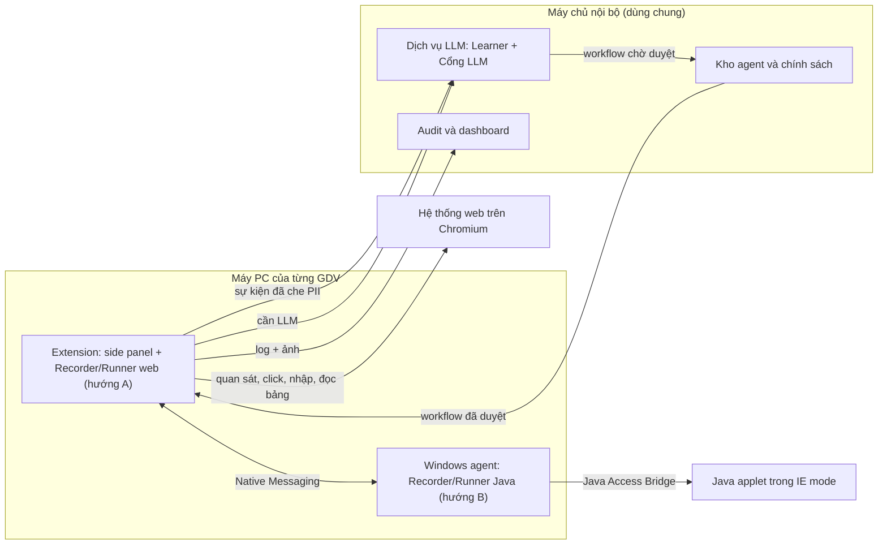
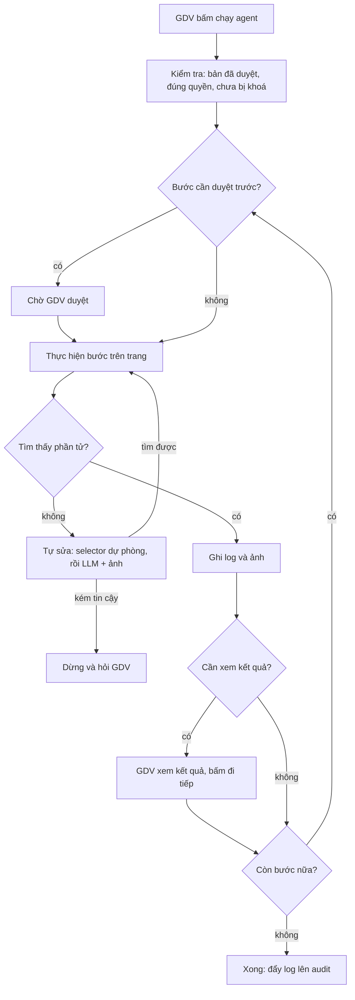

# Thiết kế PoC: Rookie Agent (agent học thao tác GDV trên web và Java applet)

Tài liệu này là nguồn thiết kế duy nhất của PoC. Bản đầy đủ có sơ đồ ở dạng Mermaid để xem trực tiếp trên GitHub hoặc VS Code.

## 1. Mục tiêu và phạm vi

PoC chứng minh một agent có thể học thao tác của giao dịch viên (GDV) qua vài lần làm mẫu, rồi tự chạy lại và được kiểm soát từng bước. Agent phải học được mọi chức năng của một ứng dụng nghiệp vụ (ví dụ CIF, chuyển tiền, hàng chờ phê duyệt), không chỉ một quy trình demo.

Hệ thống nghiệp vụ chia hai nhóm, mỗi nhóm một hướng ghi và chạy:

| Hướng | Hệ thống | Cách ghi và chạy |
| --- | --- | --- |
| **A** | Ứng dụng web chạy được trên Chromium (Chrome, Edge) | Extension Manifest V3 (mục 3A) |
| **B** | Ứng dụng chạy trong IE mode với Java applet (JDK 1.8) | Windows agent dùng Java Access Bridge (mục 3B) |

Hai hướng dùng chung định dạng event và workflow, chung Learner, kho agent, chính sách và audit.

- **Trong phạm vi:** ứng dụng web trên Chromium, Java applet trong IE mode, dữ liệu giả lập (synthetic). Bài toán demo gồm đối chiếu 2 báo cáo cuối ngày và các chức năng dạng form (tra cứu CIF, lập lệnh chuyển tiền) trên mock.
- **Ngoài phạm vi:** ứng dụng desktop khác (không phải Java), kết nối hệ thống thật, bước tiền trên hệ thống thật, tự động phê duyệt.

Nguyên tắc thiết kế:

1. Học từ làm mẫu, không viết mã riêng cho từng quy trình.
2. Ghi theo ngữ nghĩa (id, label, role), không dùng toạ độ.
3. Con người chịu trách nhiệm cuối: mỗi bước cấu hình được là tự chạy, dừng xem hoặc xin duyệt.
4. Ưu tiên API/MCP khi có; thao tác trên màn hình là phương án dự phòng.
5. Che dữ liệu nhạy cảm ngay trên máy người dùng, trước khi gửi đi.

### Yêu cầu nguồn (từ cuộc họp)

- Người nghiệp vụ tự tạo agent cho việc hàng ngày, không cần IT viết API từng việc.
- Học từ làm mẫu: làm khoảng 10 giao dịch, agent sinh cách chạy tự động, chạy thử, người xác nhận đúng thì lưu vào kho.
- Khác RPA truyền thống: có bước tư duy (so sánh, phát hiện lệch, giải thích).
- Kiểm soát từng bước, con người chịu trách nhiệm cuối, có môi trường test, không tự động phê duyệt hay chuyển tiền.
- Chia sẻ tri thức mặc định trong đơn vị, có chế độ riêng tư; agent của người giỏi được chấm điểm để người khác dùng lại.
- Mô hình triển khai phân tán: Runner chạy trên từng máy PC. Giai đoạn này chỉ làm web, các ứng dụng khác dự kiến chuyển về web. (Cập nhật sau cuộc họp: đa số hệ thống đang chạy trong IE mode với Java applet JDK 1.8, nên bổ sung hướng B.)

## 2. Kiến trúc tổng thể

Hai nơi: mỗi máy PC của GDV có Recorder và Runner (extension cho hướng A, Windows agent cho hướng B); máy chủ nội bộ dùng chung giữ dịch vụ LLM, kho agent, chính sách và audit.



Side panel của extension là giao diện duy nhất cho cả hai hướng. Với hướng B, extension chuyển lệnh (Ghi, Chạy, Dừng khẩn) cho Windows agent qua Native Messaging và nhận lại sự kiện đã che PII để gửi lên máy chủ. Máy chủ không phân biệt hai hướng ngoài trường `engine` trong event và workflow.

Vòng đời của một agent:

1. **Ghi:** GDV làm mẫu, Recorder gửi sự kiện đã che PII lên máy chủ.
2. **Học:** Learner sinh workflow từ các lần ghi; GDV xem và sửa.
3. **Thử:** workflow chạy ở sandbox; đúng như mong đợi thì lưu vào kho agent.
4. **Duyệt:** GDV xác nhận agent của mình; muốn chia sẻ cho người khác thì cần thêm người duyệt nghiệp vụ.
5. **Chạy:** máy GDV giữ bản đã duyệt và Runner chạy ngay tại máy, từng bước có kiểm soát.
6. **Giám sát:** log, ảnh và điểm chất lượng được đẩy lên audit để cải tiến agent.

## 3. Recorder

### 3A. Hướng A: extension cho web trên Chromium

Extension Manifest V3 ghi thao tác của GDV trên trang web và gửi về server nội bộ dưới dạng sự kiện có cấu trúc.

| Thành phần | Vai trò |
| --- | --- |
| Content script | Bắt click, nhập, chọn, submit; xử lý iframe cùng domain và shadow DOM; dùng MutationObserver cho trang SPA đổi nội dung không đổi URL |
| Service worker | Gom sự kiện theo phiên, che PII, gửi về server, giữ trạng thái đang ghi |
| Side panel | Bắt đầu / Dừng, gắn nhãn bước, xem lại và xoá bước ghi nhầm |
| Network observer | Ghi endpoint và mã kết quả của các API gọi sau mỗi hành động (webRequest, chỉ quan sát) |

**Cách ghi phần tử.** Mỗi phần tử lưu nhiều selector dự phòng theo thứ tự ưu tiên: id ổn định, name, label hoặc aria-label, role kèm text, vị trí tương đối trong form. Id sinh ngẫu nhiên bị loại bằng nhận dạng mẫu chuỗi.

**Quyền trong manifest.** `activeTab`, `scripting`, `storage` và `webRequest` giới hạn ở các host nội bộ. Chỉ ghi khi GDV bấm Bắt đầu và luôn hiện biểu tượng đang ghi.

### 3B. Hướng B: Windows agent cho Java applet trong IE mode

Extension không chạy được trong tab IE mode, và giao diện bên trong applet là Swing/AWT chứ không phải DOM. Hướng B vì vậy dùng một Windows agent cài trên máy GDV, đọc và điều khiển applet qua **Java Access Bridge (JAB)**, cầu accessibility chính thức có sẵn trong JRE 8.

| Thành phần | Vai trò |
| --- | --- |
| Native Messaging host | Nhận lệnh từ side panel của extension (Ghi, Dừng, Chạy, Dừng khẩn), trả sự kiện và trạng thái. Đăng ký ở `HKCU\Software\Microsoft\Edge\NativeMessagingHosts` |
| JAB reader | Đọc cây accessible của cửa sổ Java: vai trò (role), tên (name), mô tả, trạng thái, giá trị |
| Recorder Java | Nghe sự kiện focus, click, đổi giá trị qua JAB; phân loại trường và che PII trước khi trả về extension |
| Runner Java | Tìm phần tử theo selector, thực thi bằng hành động accessible (bấm, đặt text, chọn mục), đọc bảng |

**Điều kiện trên máy.** Bật JAB bằng `jabswitch -enable` (không sửa ứng dụng nghiệp vụ). DLL `WindowsAccessBridge-32.dll` hoặc `-64.dll` phải khớp bitness với JRE của ứng dụng; applet trong IE mode thường chạy JRE 32-bit.

**Cách ghi phần tử.** Selector của Java theo thứ tự ưu tiên: vai trò kèm tên accessible, nhãn đứng cạnh, đường dẫn trong cây accessible (chuỗi vai trò và chỉ số từ cửa sổ gốc). Không dùng toạ độ.

**Trường mật khẩu.** Thành phần có vai trò `password text` (`JPasswordField`) bị bỏ qua hoàn toàn, giống trường mật khẩu ở hướng A. Bảng phân loại trường (4.2) dùng chung cho cả hai hướng.

**Khác biệt so với hướng A.** Không có `api_calls` (không quan sát được mạng của applet), nên mức rủi ro được gán theo màn hình và nhãn nút (4.3). Ảnh chụp là ảnh cửa sổ ứng dụng, được che vùng nhạy cảm theo toạ độ của thành phần lấy từ JAB.

**Agent ghi trong JVM (`java-agent/`).** Một jar nhỏ nạp vào JVM của ứng dụng bằng `-javaagent`, thường qua biến môi trường `JAVA_TOOL_OPTIONS` của người dùng (`windows-agent/install/enable_java_agent.ps1`) nên không sửa ứng dụng. Nó gắn `ActionListener` vào mọi nút và ô văn bản, nên thấy hành động dù được kích bằng chuột, Enter hay phím tắt gắn với nút. Quy tắc để nó vô hại:

- **Chỉ hoạt động khi GDV bấm Ghi.** Agent Windows tạo file `recording.flag` trong thư mục `%LOCALAPPDATA%\RookieAgent` khi bắt đầu ghi và xoá khi dừng; không có file này agent Java không làm gì.
- **Không ghi ký tự gõ, không ghi giá trị.** Chỉ ghi "đã có hành động trên thành phần này": vai trò, tên, vị trí trong cây, tên màn hình. Ô mật khẩu chỉ được ghi nhận là đã nhấn Enter.
- **Chỉ ghi ra thư mục của agent trên máy này** (`java-events\<pid>.jsonl`), không gửi đi đâu.
- Đặt tên thành phần giống hệt Java Access Bridge (cùng vai trò, tên, đường dẫn), nên một cú bấm do cả hai báo chỉ thành một sự kiện.

Enter trong ô thành sự kiện `submit`, rồi bước `submit` của workflow ("Nhấn Enter trong ô"). Khi chạy lại, Java Access Bridge gọi hành động `notify-field-accept` của ô, đúng việc phím Enter làm, nên không cần gửi phím và vẫn chạy được khi cửa sổ thu nhỏ. Chưa làm: phím chức năng và phím tắt gắn với hành động không qua nút (chỉ đo được khi có Touchpoint thật); component tự viết không có tên accessible.

**Cách bắt sự kiện (đã kiểm chứng trên mock Swing, JDK 21 64-bit).**

| Thao tác | Tín hiệu từ Java Access Bridge | Event |
| --- | --- | --- |
| Gõ vào ô nhập | Đổi nội dung text khi ô đang có focus; ghi ra khi ô mất focus, trước mỗi click, và khi Dừng | `input` |
| Bấm chuột vào nút, menu | Sự kiện click chuột | `click` |
| Chuyển tab | Tab chuyển sang trạng thái `selected` | `click` |
| Tích ô chọn, nút radio | Đổi trạng thái `checked` | `click` |
| Chọn dòng trong bảng | Đổi vùng chọn của bảng; lưu số thứ tự dòng | `select` |

Ứng dụng tự xoá form sau khi gửi không bị ghi nhầm thành thao tác nhập, vì lúc đó ô không có focus.

**Giới hạn của Java Access Bridge, đã đo.** Enter trong một ô (ví dụ Enter ở ô mật khẩu để đăng nhập) đăng nhập được nhưng không sinh sự kiện nào; bấm nút bằng phím cũng không. GDV quầy thao tác nhiều bằng bàn phím, nên chỉ dùng Java Access Bridge thì workflow học ra thiếu bước gửi. Phần bổ sung nằm ở mục dưới.

**Ngôn ngữ.** PoC viết Windows agent bằng Python, khi chạy chỉ dùng thư viện chuẩn (gọi DLL của Java Access Bridge bằng `ctypes`) để không phải mang thêm gói nào vào máy nội bộ. Bản triển khai thật cân nhắc C#/.NET để đóng gói gọn.

### 3C. Hướng B2: trang web chạy trong Internet Explorer cũ (đọc bằng COM)

Hệ thống chỉ mở được bằng IE, là trang web (frameset lồng nhau, chế độ tài liệu quirks), không phải Java applet. Extension không chạy trong IE cũ và cầu nối Java không thấy gì, nên agent đọc DOM của tab IE qua COM (`Shell.Application`), không cài thêm gì.

- **Cầu PowerShell** (`windows-agent/rookie_agent/ie/ie-bridge.ps1`, chạy `-Sta`): Python nói chuyện qua JSON từng dòng, toàn ASCII. Lệnh: `tabs`, `probe`, `start`, `poll`, `stop`.
- **Bộ ghi trong trang** (`page_recorder.js`, JavaScript ES3 vì quirks mode không có `JSON`, `addEventListener`): `attachEvent` ở cấp `document` của từng khung; mỗi lần `poll` gắn lại vào khung mới nạp. Chỉ nghe khi đang Ghi.
- **Che dữ liệu trên máy GDV** (`ie/recorder.py`): ô `password`, `hidden`, tên giống mật khẩu/OTP không sinh sự kiện; ô nhạy cảm chỉ giữ loại; ô chưa phân loại là nhạy cảm; chuỗi số dài trong nhãn bị che.
- **Selector**: `frame=<tên khung lồng nhau>|id=...`, rồi `name=`, `label=`, vị trí.
- **Hợp đồng**: `engine: "ie"` cần `schema_version: 2` (bản 1 của web và java vẫn hợp lệ). Rủi ro tính theo màn hình và nhãn nút (`config/risk-rules.json`, khối `ie`), vì không thấy được API; nút chưa phân loại là `write`.
- **Bài học đo trên MSHTML thật**: chuỗi script đưa vào `execScript` phải là `[string]` thuần (chuỗi lấy thẳng từ `Get-Content` làm COM treo); biến và hàm của trang đọc bằng `InvokeMember`, không dùng cú pháp dấu chấm; giá trị `execScript` trả về không được lọt vào đầu ra; khung khác nguồn (khác máy chủ) bị từ chối `execScript`.
- Chưa có: chạy lại (Runner IE) và kiểm trên hệ thống thật. Ghi và Học thấy được trên trang quản lý; tab Luồng hiện flow đã học.

## 4. Định dạng dữ liệu

Hai định dạng JSON nối các thành phần: **event** (một hành động đã ghi) và **workflow** (quy trình đã tổng quát hoá). JSON Schema nằm trong `schemas/` và là hợp đồng giữa extension, Windows agent và server.

### 4.1 Event (Recorder sinh ra)

```json
{
  "schema_version": 1,
  "engine": "web",
  "session_id": "s-0142",
  "seq": 7,
  "ts": "2026-11-12T09:15:03Z",
  "type": "click",
  "url": "/baocao/cuoingay",
  "target": {
    "selectors": ["#btn-search", "button[name=search]", "role=button[name='Tìm kiếm']"],
    "label": "Tìm kiếm",
    "tag": "button"
  },
  "value": null,
  "value_class": null,
  "api_calls": [{"method": "GET", "path": "/api/report", "status": 200}],
  "screenshot": "s-0142/007.png"
}
```

`type` thuộc: `click`, `input`, `select`, `navigate`, `submit`.

`engine` thuộc: `web` (hướng A) hoặc `java` (hướng B). Với `java`:

- `url` là định danh màn hình: tiêu đề cửa sổ hoặc khung đang mở, ví dụ `TPSS/Chuyển tiền`.
- `target.selectors` dùng cú pháp Java, ví dụ `["role=push button[name='Tìm kiếm']", "label=Số CIF", "path=frame/panel[1]/text[0]"]`; `target.tag` là vai trò accessible.
- `api_calls` luôn là mảng rỗng.

### 4.2 Quy tắc lưu giá trị nhập

Learner cần so sánh giá trị giữa các lần ghi để nhận ra tham số, nhưng dữ liệu nhạy cảm không được rời máy. Vì vậy trường được phân loại ngay trên máy GDV (trong extension hoặc Windows agent):

| Loại trường | Ví dụ | Cách lưu trong event |
| --- | --- | --- |
| Bỏ qua | mật khẩu, OTP | Không ghi sự kiện giá trị. |
| Nhạy cảm | số tài khoản, CCCD, tên, số tiền | `value` = `null`, `value_class` = loại (ví dụ `account_number`). Learner luôn coi là tham số. |
| Không nhạy cảm | ngày, loại báo cáo, tuỳ chọn trong dropdown | `value` lưu giá trị thật để Learner so sánh giữa các lần ghi. |

Danh sách loại trường nằm trong một bảng cấu hình dùng chung cho extension và Windows agent (theo `name`, `label`, `type` hoặc vai trò accessible), mặc định là nhạy cảm khi chưa phân loại được.

### 4.3 Workflow (Learner sinh ra)

```json
{
  "schema_version": 1,
  "engine": "web",
  "id": "doi-chieu-cuoi-ngay",
  "version": 3,
  "status": "approved",
  "inputs": [
    {"name": "ngay", "type": "date"},
    {"name": "nguong_lech", "type": "number", "default": 1000}
  ],
  "steps": [
    {"id": "open_a", "action": "click", "target": {"selectors": ["#tab-a", "text=Báo cáo A"]}, "risk": "read", "mode": "auto"},
    {"id": "set_date_a", "action": "select", "target": {"selectors": ["#f-date", "label=Ngày báo cáo"]}, "value": "{ngay}", "risk": "read", "mode": "auto"},
    {"id": "search_a", "action": "click", "target": {"selectors": ["#btn-search", "text=Tìm kiếm"]}, "risk": "read", "mode": "auto"},
    {"id": "extract_a", "action": "extract_table", "target": {"selectors": ["#tbl-report"]}, "save_as": "bao_cao_a", "risk": "read", "mode": "auto"},
    {"id": "compare", "action": "compare", "inputs": ["bao_cao_a", "bao_cao_b"], "key": "id", "tolerance": "{nguong_lech}", "risk": "read", "mode": "review"},
    {"id": "save_report", "action": "save", "risk": "write", "mode": "approve"}
  ]
}
```

- `engine`: `web` hoặc `java`. Một workflow chỉ thuộc một hướng; Runner tương ứng mới chạy được nó.
- `action` của PoC: `goto`, `click`, `fill`, `select`, `read_value`, `wait_for`, `extract_table`, `compare`, `save`.
  - `read_value` đọc giá trị một trường và lưu vào biến (`save_as`) để dùng ở bước sau dưới dạng `{ten_bien}`, ví dụ số CIF vừa tra được. Giá trị chỉ nằm trong Runner trên máy GDV, không gửi lên máy chủ.
  - `wait_for` chờ một màn hình hoặc phần tử xuất hiện trước khi đi tiếp.
- `status`: `draft` → `tested` → `approved`.
- `risk` (`read` / `write` / `money`) do **luật cố định** gán, không để LLM tự quyết, dựa trên **bảng cấu hình rủi ro theo ứng dụng**:
  - Hướng A: theo endpoint gọi sau bước đó (API ghi là `write`, API tiền là `money`).
  - Hướng B: theo màn hình và nhãn nút (ví dụ nút "Lưu" là `write`, nút "Chuyển tiền" hoặc "Gửi duyệt" trên màn hình chuyển tiền là `money`).
  - Bước làm thay đổi dữ liệu mà bảng chưa phân loại thì mặc định là `write`.
- `mode` (`auto` / `review` / `approve`): xem mục 6.

Nhánh có điều kiện (ví dụ CIF đã tồn tại hay chưa) chưa được Learner bằng luật sinh ra. Runner gặp màn hình khác với lúc ghi thì dừng và hỏi GDV.

## 5. Learner

Learner biến 3 đến 10 lần ghi thành một workflow có tham số: so sánh các lần làm với nhau, rồi hỏi LLM ở những chỗ còn mơ hồ.

1. **Chuẩn hoá:** gộp nhiều lần gõ phím thành một thao tác điền, bỏ click trùng.
2. **Căn chỉnh các phiên:** bước giống nhau ở mọi lần là bước cố định; giá trị khác nhau thành tham số.
3. **LLM diễn giải:** nhận bản tóm tắt các phiên kèm ảnh màn hình để đặt tên bước, nêu ý định, suy ra kiểu tham số và phát hiện bước có điều kiện.
4. **Gán mức rủi ro bằng luật** (xem 4.3).
5. **Người dùng duyệt:** xem workflow và form đầu vào sinh ra, sửa nếu cần.
6. **Chạy thử:** 1 đến 3 giao dịch mẫu ở sandbox; đúng như mong đợi thì lưu vào kho agent.

Giới hạn: từ vài lần ghi chỉ tổng quát hoá được các biến thể đã thấy. Gặp nhánh chưa từng thấy, agent dừng và hỏi GDV thay vì đoán.

Bản PoC đầu tiên của Learner dùng `RuleBasedClient` (bước 1, 2, 4 bằng luật; bước 3 để sau khi có LLM thật).

## 6. Runner và kiểm soát từng bước

Runner chạy ngay trên máy của từng GDV trong phiên đăng nhập của chính họ: hướng A là một phần của extension, hướng B là một phần của Windows agent và nhận lệnh từ side panel qua Native Messaging. Vòng điều khiển (chế độ kiểm soát, Dừng khẩn, chính sách, log) giống nhau ở hai hướng; chỉ khác phần tìm phần tử và thực thi. Mỗi bước có một chế độ kiểm soát do người dùng cấu hình trong giới hạn mà mức rủi ro cho phép.

| Chế độ | Hành vi | Dùng cho |
| --- | --- | --- |
| `auto` | Chạy liền, không dừng | Bước chỉ đọc dữ liệu |
| `review` | Chạy xong dừng để người xem kết quả rồi cho đi tiếp | Nhập liệu, kết quả đối chiếu |
| `approve` | Dừng trước khi chạy, chờ duyệt (maker-checker) | Bước ghi dữ liệu, giao dịch tiền |

Quy tắc cứng: bước `money` không thể đặt `auto`; bước `write` luôn là `approve`. Trong PoC, bước `money` chỉ được chạy trên mock và luôn dừng chờ duyệt. Agent không bao giờ tự bấm Duyệt thay người kiểm soát (checker): agent của checker chỉ mở hàng chờ, lọc và kiểm tra giao dịch, cú bấm Duyệt do người bấm. Người lập và người duyệt là hai tài khoản khác nhau nên là hai agent riêng. Mọi lần chạy có nút Dừng khẩn và ghi log từng bước kèm ảnh màn hình. Workflow mới luôn chạy ở sandbox trước khi được phép chạy ngoài.

Self-healing bằng LLM và ảnh (bước 2 bên dưới) trong PoC chỉ làm cho hướng A; hướng B dừng ở selector dự phòng rồi hỏi GDV.

**Tự sửa khi giao diện đổi (self-healing).** Khi selector không còn khớp:

1. Thử lần lượt các selector dự phòng đã ghi.
2. Nếu vẫn lỗi, LLM nhận ảnh màn hình và mô tả phần tử để tìm phần tử tương đương.
3. Độ tin cậy dưới ngưỡng thì dừng và hỏi người dùng.
4. Sửa thành công thì đề xuất cập nhật workflow; chỉ lưu khi người dùng duyệt.



**Mô hình phân tán trên từng máy PC.**

| Vấn đề | Cách xử lý |
| --- | --- |
| Cài đặt và cập nhật | Hướng A: Runner nằm trong extension, phát hành và cập nhật qua kho extension nội bộ hoặc chính sách của IT, máy GDV không cần cài thêm gì. Hướng B: máy GDV cài thêm Windows agent (đóng gói một file cài, kèm đăng ký Native Messaging host) và bật Java Access Bridge; cần bộ phận an toàn thông tin duyệt |
| Phát workflow xuống máy | Máy chỉ nhận bản đã duyệt từ kho agent, kiểm tra version và chữ ký trước khi chạy, rồi giữ bản sao trên máy |
| Quyền và định danh | Chạy trong phiên đăng nhập của chính GDV; mỗi lần chạy ghi mã người dùng, mã máy và version agent; không dùng tài khoản chung |
| Điều khiển tập trung | Chính sách (agent nào, vai trò nào được chạy) và lệnh khoá agent được kéo về máy định kỳ; bị khoá thì Runner dừng ở bước kế tiếp |
| Gọi LLM | Máy không gọi LLM trực tiếp, chỉ qua cổng LLM nội bộ và chỉ gửi dữ liệu đã che PII |
| Xử lý dữ liệu | Trích xuất bảng và tính đối chiếu ngay trên máy; chỉ các dòng lệch đã che mới gửi lên khi cần LLM giải thích |
| Mất kết nối | Bước cần máy chủ hoặc LLM thì dừng an toàn và báo GDV; log và ảnh được đệm trên máy, đẩy lên khi có mạng lại |
| Kiểm thử | Workflow web chạy thử bằng Playwright trên sandbox ở máy chủ trước khi được phát xuống máy. Workflow Java chạy thử bằng Windows agent ở chế độ thử trên một máy Windows có JRE 8 và mock Swing |

### 6.1 Giao diện đổi mà không phải học lại

Mục tiêu: hệ thống ngân hàng đổi giao diện (id đổi, ô dời chỗ, thêm cột) thì agent vẫn chạy được; chỗ nào không chắc thì hỏi đúng một bước, không bắt GDV ghi 3 lần rồi Học lại.

1. **Nhiều dấu hiệu cho mỗi bước.** `target` giữ id, name, nhãn đứng cạnh, loại ô, khung trang, vị trí theo loại thẻ và chữ xung quanh (không giữ giá trị nhập). Runner chấm điểm từng ứng viên theo các dấu hiệu (điểm bằng chứng của task 2.15) và chọn khi điểm cao nhất vượt ngưỡng và cách xa ứng viên thứ hai. Không đạt thì dừng và hỏi (quy tắc 9).
2. **Sửa một bước khi không tìm thấy.** Runner khoanh tối đa 3 ứng viên trên màn hình (viền màu trong trang, không bấm gì) và hỏi GDV «Có phải ô này?». GDV chọn một ô hoặc chọn «Không có» (dừng). Lựa chọn thành bản sửa của agent: version mới, chỉ đổi `target` của bước đó, giữ nguyên `risk`/`mode`, ghi audit, và chỉ dùng chung sau khi người duyệt agent Duyệt lại. Trong lúc chờ Duyệt, chỉ GDV đã chọn mới chạy được bản sửa, và chỉ các bước `read`.
3. **Dấu vân tay màn hình.** Lúc Học, mỗi màn lưu một dấu vân tay: tập (loại ô, nhãn) và tên khung, không có giá trị. Trước khi chạy, Runner so với màn đang mở; lệch quá ngưỡng thì báo «Màn hình đã đổi» và đề nghị «Chạy thử (chỉ đọc)» để biết bước nào cần chỉ lại, trước khi dùng với khách thật.
4. **Lời gọi lên máy chủ làm bằng chứng.** Với bước `read`, request đã ghi (phương thức, đường dẫn bỏ phần sau `?`, mã trạng thái) là dấu hiệu phụ: sau khi thao tác, có lời gọi cùng hình dạng trả về thành công thì tăng độ tin cậy. Không gọi thẳng máy chủ thay cho thao tác; bước `write`/`money` luôn đi qua giao diện và chờ Duyệt.

### 6.2 Nhận lệnh từ chứng từ (giấy uỷ nhiệm chi)

GDV đưa giấy uỷ nhiệm chi (UNC) vào thay vì gõ lệnh; agent tách các trường làm tham số cho luồng chuyển tiền đã học.

1. **Đầu vào.** Ảnh quét hoặc chụp (PNG/JPG/PDF) chọn trong tab Trợ lý. PoC chỉ dùng mẫu UNC giả lập trong `mock-site/`.
2. **Đọc trên máy hoặc máy chủ nội bộ.** OCR chạy qua một interface `DocReader`, luôn có bản chạy offline để test (đọc từ file mẫu có sẵn nội dung). Ảnh không rời máy GDV khi chưa che: nếu phải gửi máy chủ nội bộ thì chỉ gửi qua kênh nội bộ, không lưu ảnh ở máy chủ sau khi đọc xong.
3. **Tách trường.** Kết quả là các trường có tên theo bảng phân loại trường: `so_tai_khoan_chuyen`, `ten_nguoi_chuyen`, `so_tai_khoan_nhan`, `ten_nguoi_nhan`, `ngan_hang_nhan`, `so_tien`, `so_tien_bang_chu`, `noi_dung`, `ngay`, mỗi trường kèm độ tin cậy. Số tiền bằng số và bằng chữ phải khớp nhau, không khớp thì đánh dấu đỏ.
4. **GDV soát từng trường (bắt buộc).** Hiện ảnh gốc cạnh từng trường, GDV sửa hoặc xác nhận. Trường dưới ngưỡng tin cậy hoặc lệch số/chữ không cho qua khi chưa sửa. Chỉ sau khi xác nhận, các trường mới thành tham số `{...}` của luồng.
5. **Chạy như lệnh gõ.** Từ đây giống Gate 5: Trợ lý chọn agent đã duyệt khớp loại chứng từ, Runner chạy, bước `write` chờ GDV Duyệt, bước `money` dừng chờ người kiểm soát bấm Duyệt. Agent làm tới đúng phần việc của vai trò người đang chạy (chính sách mục 6, quyền của chính phiên đăng nhập), phần còn lại chuyển cho người có vai trò tiếp theo.
6. **Lưu và audit.** Không lưu ảnh và giá trị trường trong trace hay audit; audit chỉ ghi loại chứng từ, tên các trường, độ tin cậy và ai đã xác nhận.

### 6.3 Chạy mô phỏng bằng request (hướng B, Internet Explorer)

GDV Ghi một lần (thao tác và request/response của trang), Học thành luồng, rồi ở tab «Luồng đã học» nhập giá trị mới (ví dụ số CIF) và bấm **Chạy mô phỏng**. Agent không bấm, không điền gì trên giao diện: nó gửi lại các request đã học và sơ đồ sáng lần lượt từng bước, mỗi bước hiện thao tác, request gửi đi, dữ liệu trả về, thời gian và trạng thái.

1. **Request mẫu lúc Dừng ghi** (`ie/replay.py`, `templates`). Bộ ghi trong trang giữ method, url, header trang tự đặt (bỏ header có cookie, token, mật khẩu), body (tối đa 16000 ký tự). Giá trị GDV đã gõ được thay bằng dấu `⟦eN⟧` của sự kiện đã gõ nó (cả dạng mã hoá URL), không lưu giá trị. Request có mật khẩu/OTP đã che (`"***"`) hoặc body bị cắt thì đánh dấu không gửi lại được. Mẫu nằm trong file bản ghi trên máy GDV, không gửi lên máy chủ học.
2. **Gắn vào bước lúc Học** (`attach`). Mỗi request thuộc bước của thao tác ngay trước nó; request lúc tải trang (trước thao tác đầu tiên) hoặc request lỗi lúc ghi bị bỏ. Dấu `⟦eN⟧` thành giá trị của bước: `⟦tên_tham_số⟧` nếu bước nhận tham số, chữ cố định nếu không. Dấu không bước nào giải thích được làm request đó không chạy được (`unresolved`). Lưu ở `flows[].requests` trên máy.
3. **Gửi trong phiên của GDV** (lệnh trang `send`/`sendres`). Request được gửi bằng XHR gốc của chính trang IE đã đăng nhập, ở đúng frame lúc ghi: cookie phiên (kể cả HttpOnly) đi theo mà agent không đọc. Giao diện không đổi. Trả lời giữ trong bộ nhớ.
4. **Giới hạn.** Chỉ bước `read` được gửi, hoặc bước `write` chỉ vì mặc định (không luật `write`/`money` nào của khối `ie` trong `config/risk-rules.json` khớp nhãn và màn hình; agent đọc cùng bảng luật, không đọc được thì không hỏi) mà GDV đã xác nhận «Chỉ xem — gửi». Lần chạy thật đầu tiên agent hỏi một lần, kèm danh sách lời gọi (phương thức và đường dẫn, không có nội dung): «Bước «…» chỉ xem dữ liệu, không thay đổi gì trên hệ thống?». «Chỉ xem» được ghi trên luồng lưu ở máy này, theo từng bước (đã xác nhận chỉ xem, và giờ; không lưu giá trị hay danh tính), lần sau gửi luôn; trang luồng hiện xác nhận này và cho rút lại (quay về hỏi). «Có thay đổi», không trả lời hoặc Dừng khẩn thì từ chối như cũ và không nhớ gì. Bước `money` không bao giờ được hỏi; bước khớp luật `write` rõ ràng (ví dụ «Lưu») bị từ chối không hỏi; mức rủi ro của bước trong workflow trên máy chủ không đổi. Bản sao (twin) không đổi. Bước `write`/`money` còn lại có request thì dừng («dùng Chạy trên màn hình, có Duyệt»); bước chỉ thao tác màn hình thì bỏ qua. Máy chủ trả mã ≥400, `//EX` của GWT, hoặc trang đăng nhập thì dừng, không thử đoán. Thiếu giá trị thì hỏi.
5. **Hiển thị và audit.** Dữ liệu trả về được rút gọn (`ie/response_view.py`: JSON thành cặp khoá/giá trị và bảng, GWT thành các chuỗi đọc được, HTML thành ô bảng và chữ) và chỉ hiện trên trang quản lý của máy GDV. Audit chỉ ghi tên luồng, các bước và trạng thái.
6. **Chưa làm.** Giá trị lấy từ trả lời của bước trước để dùng ở bước sau; mã chống giả (XSRF) phải lấy mới mỗi lần, cần thử trên UAT để biết dạng. (Đã làm ở 6.4.)

### 6.4 Luồng theo API (mỗi nút = một bước, gửi cả loạt lời gọi của bước đó, chạy như n8n)

Chỉ ghi cú bấm thì không chạy lại được. Luồng phải biết đến bước nào thì gọi API gì, gửi gì, và lấy gì từ trả lời để dùng cho bước sau.

1. **Ghi đủ các loại request.** XHR/ActiveX XMLHTTP như 6.3. Form gửi thật (Enter hoặc nút submit): action, method, các ô (giá trị đọc trong bộ nhớ; ô mật khẩu và ô tên PIN/OTP là `***`; ô ẩn được đọc vì trình duyệt vốn gửi nó). Chụp ngay sau cú bấm bằng bộ hẹn giờ của bộ ghi (sau khi script của trang xong), hoặc lúc trang rời đi. Mỗi tài liệu mới của một khung báo nó đến từ đâu (`nav`): sau một form là POST của form đó, không thì là GET trang. Tài liệu đã mở trước thao tác đầu tiên không phải request của GDV.
2. **Giữ mọi API giữa hai thao tác**, kể cả lúc mở màn hình. Bỏ request lỗi lúc ghi và request lặp ≥3 lần y hệt (trang tự hỏi định kỳ), trừ khi API sau cần trả lời của nó.
3. **Dữ liệu nối.** Lúc Dừng ghi, trả lời đầy đủ (≤100 KB mỗi cái) còn trong bộ nhớ. Một giá trị trong url/body/header (≥4 ký tự, có chữ số hoặc dài ≥16, không phải tên lớp Java) mà một trả lời trước có thì thành `⟦lN⟧` với luật lấy lại: đường dẫn JSON, vị trí trong bảng chuỗi GWT, hoặc 16 ký tự ngay trước nó. Chỉ lưu luật, không lưu giá trị. Token (`token|secret|csrf|xsrf|nonce`) không rõ nguồn thành `***` và API đó không gửi lại được. Token không còn bị che ngay trong trang (chỉ mật khẩu/PIN/OTP), để tìm được nguồn.
4. **Học thành nút API** (`flows[].api`, trên máy GDV). Mỗi nút: tên «thao tác → METHOD đường dẫn» (hoặc «Mở màn hình → …»), khung, method, url, header, body mẫu, các liên kết, risk của bước gây ra nó (mở màn hình là `read`), trạng thái gửi được hay không và vì sao.
6. **Bộ nhớ phiên (cache) cho tra cứu.** Một lần chạy xong (chỉ gồm lời gọi `read`) được nhớ trong bộ nhớ của agent, khoá theo người dùng máy, tab IE (phiên đăng nhập), luồng và giá trị nhập. Cùng khách trong phiên thì hiện lại ngay, ghi rõ «Lấy từ bộ nhớ phiên lúc …», không gọi máy chủ. Hết hạn sau 5 phút (`cache_seconds`). Bị xoá khi: đóng tab IE, trả lời là trang đăng nhập, bấm «Xoá bộ nhớ phiên», tắt agent. «Làm mới» luôn gọi lại. Lần chạy dừng ở nút ghi/tiền không được nhớ. Không ghi đĩa, không gửi máy chủ. Trợ lý dùng cách chạy này cho luồng chỉ gồm nút `read`; luồng có ghi/tiền vẫn chạy trên màn hình, có Duyệt.
7. **Một bước là một nút, gửi cả loạt lời gọi của nó.** Một thao tác của GDV (ví dụ bấm tên khách hàng để đưa khách vào phiên trên TouchPoint) có thể bắn khoảng 30 lời gọi (cặp getToken và TPClassLoader nối nhau). Mẫu, liên kết và cách gửi vẫn theo từng lời gọi, nhưng các lời gọi liên tiếp cùng một bước (hoặc cùng «Mở màn hình») gộp thành một nhóm (`group`), và sơ đồ, lần chạy, bản sao, tệp n8n đều coi nhóm là một nút: một cột mốc, một trạng thái, một quyết định. Bước `write`/`money` bị từ chối một lần cho cả nhóm (chạy thật) hoặc hỏi Duyệt một lần cho cả nhóm (bản sao; luật KSV chặng cuối áp cho nhóm cuối). Trong nhóm các lời gọi gửi lần lượt; một lời gọi hỏng thì dừng và nói tên bước cùng lời gọi (method và đường dẫn); mọi lời gọi của nhóm luôn được liệt kê, cái chưa gửi ghi «chưa gửi». Luồng lưu trước khi có nhóm được gom lại khi nạp, không cần ghi lại. Tệp n8n vẫn một nút HTTP Request cho mỗi lời gọi (n8n cần vậy), đặt tên dưới bước của nó và có một ghi chú dán quanh các lời gọi của bước.
8. **Chạy trên sơ đồ.** Sơ đồ vẽ các nút (mỗi bước một nút, ghi số lời gọi, bấm vào xem danh sách lời gọi). Mỗi nút hiện đầu vào lấy từ đâu (GDV nhập hay trả lời của API nào), request đã gửi, dữ liệu trả về, thời gian, trạng thái. Request gửi từ trang IE đã đăng nhập; khung lúc ghi không còn thì gửi từ khung gốc (cùng trang, cùng phiên). Giá trị nối lấy từ trả lời vừa nhận; không lấy được thì dừng hỏi. Đăng nhập không bao giờ chạy lại. Nút `write`/`money` dừng, không gửi.
9. **Giá trị của lần đăng nhập lấy từ trang đang mở.** Lần chạy thật không đăng nhập lại, nên một giá trị mà luật nối lấy từ trả lời đăng nhập (mã phiên) được lấy từ chính trang IE của GDV: khi bắt đầu chạy, agent cho trang nhớ trong bộ nhớ của nó (`window.__rkLastReq`, tối đa 3 body gần nhất cho mỗi đường dẫn, 30 đường dẫn, mật khẩu đã bị che; không ghi ra đâu, không gửi đi đâu, không ghi lại gì) rồi đặt body mẫu của nút lên body mới nhất vừa khớp (chữ cố định phải giống hệt, mỗi `⟦tên⟧` là một đoạn bất kỳ) và lấy đoạn của đúng giá trị đó. Màn hình hiện nguồn «phiên đang mở của trang IE». Trang chưa gọi API đó từ lúc agent theo dõi thì không có gì để lấy: agent dừng và nói GDV bấm Ghi rồi Dừng một lần (bật «Ghi yêu cầu») hoặc mở màn hình một lần rồi Chạy lại. Chạy thử trên bản sao không đổi (lấy từ trả lời giả).
10. **getToken → Bearer (TouchPoint).** Mỗi dịch vụ là hai lời gọi: `postAuthentication.fisglobal?method=getToken&claims=…` (trả đúng chuỗi token, hoặc JSON `{"token":…}`), rồi `TPClassLoader` với header `Authorization: Bearer <token>`. Bộ ghi giữ header `Authorization` và các header kiểu token trong bộ nhớ như token trong body (Cookie, mật khẩu thì không bao giờ), để lúc Dừng ghi tìm ra nguồn: giá trị trùng một trả lời trước thì thành `⟦lN⟧` (luật `whole` = cả trả lời đã cắt khoảng trắng, hoặc đường dẫn JSON); không có nguồn thì thành `***` và nút đó không gửi lại được. Không có token nào nằm trên đĩa. Lúc chạy, nút getToken được gửi lại trước, token mới điền vào `Authorization` của nút sau. Nút getToken giống hệt lặp ≥3 lần vẫn được giữ nếu có nút sau nối tới.
11. **Trả lời là một file (xuất báo cáo PDF, sao kê Excel).** File là dữ liệu của khách: chỉ nằm trên máy GDV, trong `%USERPROFILE%\Downloads\Rookie\` (đổi được bằng `download_folder` trong cài đặt của agent), tên `<tên luồng>-<yyyyMMdd-HHmmss>.<đuôi>`; đuôi lấy từ tên file máy chủ gợi ý hoặc content-type, chỉ nhận đuôi của tài liệu (pdf, xls, xlsx, csv, doc, docx, zip, txt, rtf, ảnh), còn lại là `.bin`. Không gửi lên máy chủ, không vào bản ghi, shape, sự kiện, LLM hay log. Ba đường giao file đều được ghi và chạy lại chung một cách:
    - **(a) XHR** có trả lời là file: bộ ghi nhận ra bằng header (`Content-Disposition: attachment`, hoặc content-type là tài liệu/ảnh; không đọc text, không đọc byte). Bản ghi chỉ giữ `file`: content-type, kích thước, mẫu tên (số thành `#`, chữ thành `A`).
    - **(b) form POST/GET** ra khung hoặc cửa sổ: bộ ghi ghi method, action, các ô (làm mẫu body như 6.4.1) và `target`. Trả lời tải về thì không có tài liệu mới; bộ ghi thấy trang bắt đầu rời đi (`beforeunload` sau lúc gửi) mà sau 4 giây không có tài liệu nào thì coi đó là request có trả lời là file (`file.guess`). Form bị script của trang chặn (không rời đi) không thành request.
    - **(c) `window.open(url)`**: bộ ghi bọc `window.open` (cùng điều kiện «Ghi yêu cầu» như bộ ghi XHR), ghi GET và url; nếu cửa sổ mở ra là một trang thì request của trang đó thay thế, không thì coi là file như (b).
    
    Nút học ra có `kind: "file"` (`via` là cách giao: `xhr`, `form`, `open`). Lúc chạy, request gửi từ trang như mọi lời gọi khác (cùng phiên, cùng liên kết token). Byte lấy nguyên vẹn, không qua JScript: trang giữ đối tượng XHR, cầu nối PowerShell đọc `responseBody` (byte[]) qua COM rồi trả base64 cho Python. Quá 50 MB thì dừng và nói rõ. Trả lời là trang HTML hay chữ thay vì file (hết phiên, trang lỗi) thì dừng theo `refused()`. Chi tiết bước hiện «Đã lưu file: tên (KB)» cùng «Mở file» và «Mở thư mục» (`POST /api/file/open`, chỉ mở đường dẫn nằm trong thư mục Rookie và loại file tài liệu, bằng `os.startfile`). Bản sao (twin) trả file giả rất nhỏ, không lưu gì, ghi «BẢN SAO». Lần chạy có file không vào bộ nhớ phiên. Xuất, in, tải là `read` (luật `ie` trong `config/risk-rules.json`: nhãn bắt đầu bằng Xuất, In, Tải, Báo cáo, Export, Print, Download; trên màn hình chuyển tiền/thanh toán/rút/nộp thì luật cũ thắng). Chạy trên màn hình: IE hiện thanh Mở/Lưu của riêng nó mà agent không bấm được chắc chắn, nên luồng có file được chạy bằng request (Chạy mô phỏng); bước bấm nút xuất trên màn hình dừng và nhắc GDV bấm Lưu.

## 7. Bước tư duy: đối chiếu 2 báo cáo

Ngoài lấy dữ liệu, agent so sánh theo rule của người dùng và giải thích chênh lệch.

- **Chia việc giữa mã và LLM.** Phần tính toán chắc chắn do mã làm: ghép dòng theo khoá (mã giao dịch, số tài khoản), cộng tổng, tìm dòng thiếu hoặc lệch số. LLM chỉ làm phần cần phán đoán: phân loại nguyên nhân lệch, gợi ý cách xử lý, soạn ghi chú.
- **Rule do người dùng nhập bằng ngôn ngữ tự nhiên**, ví dụ "lệch dưới 1.000 đồng do làm tròn thì bỏ qua". Hệ thống chuyển rule thành tham số của bước đối chiếu (ví dụ `nguong_lech`) và hiển thị lại để người dùng xác nhận.
- **Kết quả đầu ra:** bảng lệch gồm khoá, giá trị hai bên, chênh lệch, nguyên nhân dự đoán và độ tin cậy; kết luận khớp hoặc không khớp (không khớp thì dừng ở chế độ `review`); toàn bộ bước tính được lưu lại để kiểm tra lại, không chỉ lưu kết luận của LLM.

## 8. Kho agent, chấm điểm và chia sẻ

| Thuộc tính | Nội dung |
| --- | --- |
| Version | Mỗi lần sửa tạo version mới, quay lại được bản cũ |
| Điểm | Tỷ lệ chạy đúng, số bước phải sửa tay, thời gian tiết kiệm so với làm thủ công |
| Chia sẻ | **Mặc định riêng tư** (chỉ chủ agent). Chỉ chủ agent mới cho phép chia sẻ (nhóm hoặc toàn đơn vị) và chính chủ agent duyệt việc đó. Trước khi chia sẻ, chủ agent xem trước đúng nội dung sẽ chia sẻ (các bước, nhãn, tên tham số; không có giá trị nào) |
| Clone | Người khác sao chép agent và chỉnh rule theo cách làm của mình; bản gốc không đổi |

**Bản ghi thô được giữ** (quyết định của chủ dự án) để agent học liên tục và hình thành một bộ tri thức. Vì vậy bản ghi chỉ được chứa dữ liệu đã che (mục 4.2, 9), chỉ chủ sở hữu đọc được, và chủ sở hữu xoá được bất cứ lúc nào. Dòng của danh sách dữ liệu (tài khoản, khách hàng) chỉ lưu vị trí («dòng 2»), không lưu chữ, vì chữ đó có thể là tên khách.

**Tri thức hai tầng.** Tầng cá nhân (rule và ghi nhớ riêng của từng người) tách khỏi tầng chung. Phản hồi sửa lỗi của người dùng chỉ đi vào tầng chung sau khi người sở hữu xác nhận và có người duyệt nghiệp vụ. Cách này tránh tình huống hai người làm khác nhau mà hệ thống không biết học theo ai.

## 9. Bảo mật, che PII và audit

| Lớp | Biện pháp |
| --- | --- |
| Thu thập | Chỉ ghi khi bấm Bắt đầu, có biểu tượng đang ghi; bỏ qua mật khẩu và OTP; giá trị nhạy cảm không lưu (4.2) |
| Che PII | Số tài khoản, CCCD, tên, số tiền được thay bằng mã giữ chỗ trước khi gửi; ảnh màn hình được che vùng nhạy cảm |
| Truyền và lưu | Kênh mã hoá về server nội bộ; LLM chạy on-prem hoặc trong vùng mạng được duyệt |
| Quyền | Agent chạy dưới quyền của chính người dùng; không có tài khoản dùng chung |
| Audit | Log từng bước: ai chạy, agent version nào, API nào, kết quả, người duyệt, ảnh màn hình |
| Rủi ro | Phân cấp `read` / `write` / `money`; bước `money` luôn cần duyệt trước; trong PoC bước `money` chỉ chạy trên mock với dữ liệu synthetic |

**Minh bạch với GDV.** Nói rõ mục đích là tạo agent hỗ trợ công việc của chính họ, không dùng để giám sát hay chấm điểm cá nhân, và có cơ chế xoá bản ghi của mình.

**Cần xác nhận với bộ phận an toàn thông tin:** chính sách cài extension và Windows agent trên máy giao dịch, việc bật Java Access Bridge, vị trí đặt LLM, thời gian lưu log và ảnh màn hình.

## 10. Mock site và kịch bản demo

Demo chạy trên hai hệ thống giả lập với dữ liệu synthetic: một web (hướng A) và một ứng dụng Java Swing (hướng B).

**Mock site (web, `mock-site/`) gồm:** trang đăng nhập, Báo cáo A (đối chiếu từ hệ thống nguồn 1), Báo cáo B (hệ thống nguồn 2), mỗi báo cáo có bộ lọc ngày và bảng kết quả xuất được. Dữ liệu sinh sẵn có một số dòng lệch cố ý (lệch số, thiếu dòng, lệch do làm tròn). Có một công tắc "giao diện mới" đổi id và vị trí nút để thử self-healing. Ngoài ra có ba chức năng dạng form: tra cứu và mở CIF, lập lệnh chuyển tiền, hàng chờ phê duyệt. Có hai tài khoản: người lập (maker) và người duyệt (checker); checker không duyệt được lệnh do chính mình lập.

**Mock Swing (`mock-java/`) gồm:** một ứng dụng Java Swing độc lập giả lập TPSS với đăng nhập, CIF, chuyển tiền và phê duyệt, cùng dữ liệu synthetic theo seed và công tắc "giao diện mới". Java Access Bridge đọc Swing độc lập giống hệt applet, nên test không cần dựng IE mode và plugin Java. Việc kiểm tra trên applet thật trong IE mode là task spike 1.7.

**Kịch bản khoảng 12 phút:**

1. Bật record trong side panel, làm đối chiếu 3 lần với các ngày khác nhau.
2. Bấm Học: hiện workflow sinh ra, các bước và form đầu vào.
3. Chạy với ngày mới: agent tự chạy các bước đọc, dừng ở bước đối chiếu chờ xem kết quả.
4. Xem bảng lệch kèm nguyên nhân dự đoán; sửa rule làm tròn rồi chạy lại.
5. Bật công tắc đổi giao diện: agent tự tìm lại nút và chạy tiếp, ghi nhận đề xuất cập nhật workflow.
6. Mở dashboard: thời gian so với làm thủ công, tỷ lệ bước đúng, audit trail.
7. Người dùng thứ hai clone agent và chỉnh rule theo cách làm của mình.
8. Học một chức năng khác trên mock Swing: ghi 3 lần "tra CIF rồi lập lệnh chuyển tiền", bấm Học, chạy với khách hàng mới; agent dừng chờ duyệt ở bước chuyển tiền.

`docs/demo-reference.html` là bản mô phỏng tương tác một file của kịch bản này, dùng để tham khảo hành vi và giao diện.

## 11. Kế hoạch, KPI và rủi ro

PoC làm trong 3 tuần với ba cổng kiểm (chi tiết việc và tiêu chí nghiệm thu ở `docs/tasks.md`).

| Cổng | Tuần | Điều kiện qua cổng |
| --- | --- | --- |
| Gate 1: ghi được | 1 | 3 lần làm mẫu được ghi đủ và xuất được event JSON, ở cả mock web và mock Swing |
| Gate 2: chạy lại đúng | 2 | Workflow sinh ra chạy đúng với dữ liệu mới; học được chức năng "tra CIF rồi lập lệnh chuyển tiền" mà không viết mã riêng |
| Gate 3: demo đủ kịch bản | 3 | 8 bước trong mục 10 chạy được, kèm số đo thời gian và độ đúng |

Hướng B làm tăng khối lượng so với ước lượng 3 tuần ban đầu; mốc thời gian cần thống nhất lại sau khi có kết quả spike 1.7.

Các tiêu chí qua cổng là đề xuất từ kịch bản demo, cần thống nhất với khối vận hành.

**Chỉ số đo**

| Chỉ số | Cách đo |
| --- | --- |
| Bước tự chạy đúng | Số bước chạy đúng không cần sửa tay trên tổng số bước, qua các lần chạy với dữ liệu ngày mới |
| Phát hiện dòng lệch | Tỷ lệ dòng lệch cố ý trong dữ liệu mock mà agent tìm ra đúng |
| Tự sửa khi đổi giao diện | Số lần tự tìm lại đúng phần tử trên tổng số lần đổi giao diện thử |
| Thời gian | Thời gian agent chạy so với GDV làm thủ công cùng quy trình |

**Rủi ro và hướng xử lý**

| Rủi ro | Hướng xử lý |
| --- | --- |
| Tổng quát hoá kém từ vài lần ghi | Ghi nhiều biến thể; gặp nhánh chưa thấy thì agent dừng và hỏi GDV |
| Máy giao dịch không cho cài extension | Xin duyệt chính sách sớm; chạy PoC trên máy thử nghiệm trong lúc chờ |
| Ứng dụng nghiệp vụ chạy IE mode với Java applet | Hướng B: Windows agent dùng Java Access Bridge |
| Applet không lộ tên accessible cho thành phần | Spike 1.7 kiểm tra sớm trên hệ thống thật; dự phòng bằng Java agent nghe `AWTEventListener` |
| Máy giao dịch không cho cài Windows agent hoặc bật Java Access Bridge | Xin duyệt chính sách sớm; chạy PoC trên máy thử nghiệm trong lúc chờ |
| Bitness của JRE khác với Windows agent | Agent chọn DLL 32 hoặc 64-bit theo JRE của ứng dụng; kiểm tra trong spike 1.7 |
| Ứng dụng desktop khác (không phải web, không phải Java) | Ngoài phạm vi PoC |
| Vị trí đặt LLM chưa chốt | Xác nhận với bộ phận an toàn thông tin; PoC chỉ dùng dữ liệu synthetic |

**Câu hỏi mở**

- Ngưỡng đạt cho từng chỉ số (cuộc họp chưa nêu).
- Quy trình thật đầu tiên để thử sau PoC: cuộc họp nhắc đối chiếu cuối ngày và hành trình chuyển tiền ngoại tệ.
- Ai duyệt agent trước khi vào kho chung.
- Chính sách cài extension và vị trí đặt LLM trong ngân hàng.

## 12. Bản sao quy trình (Process Digital Twin)

Từ Gate 8, mỗi luồng đã là một bản sao chạy được của một thao tác. Gate 9 nâng lên thành bản sao của cả quy trình đầu cuối nhiều vai trò, ví dụ GDV tra CIF và lập lệnh chuyển tiền, rồi KSV duyệt. Bản sao phục vụ bốn việc: chạy thử không đụng hệ thống thật, nhìn quy trình thật, đo và tìm điểm nghẽn, thử «nếu… thì…».

```
Máy GDV/KSV (agent, extension)       Máy chủ nội bộ (server/app/twin/)
 ghi: sự kiện đã che + thời gian  ─►  Nhật ký quy trình
 khung trả lời (đã xoá giá trị)       ├─ Khám phá: sơ đồ, biến thể, số ca
 Chạy thử trên bản sao  ◄───────┐     ├─ Đo: thời gian bước, chờ, làm lại, lỗi, độ trễ API
                                │     ├─ Mô hình quy trình đầu cuối (chặng, vai trò)
 trang «Bản sao quy trình»  ◄───┴──── └─ Mô phỏng nếu… thì… (sự kiện rời rạc, có seed)
```

1. **Nhật ký quy trình** (`twin/log.py`). Dựng từ các phiên đã lưu. Mỗi dòng gồm:
   - ca;
   - bước của workflow: phiên đã dùng để Học thì theo bước đã học; phiên khác thì khớp theo phần tử đích, nhận khi ít nhất 60% thao tác khớp;
   - vai trò (`maker` hoặc `checker`);
   - thời điểm bắt đầu và kết thúc;
   - kết quả: xong, làm lại hoặc lỗi;
   - độ trễ API.

   Sự kiện `schema_version` 3 cho phép `api_calls` ở hướng ie, có thêm `ms`. Đường dẫn của mỗi lời gọi bỏ query, không có body.

   Phiên gửi kèm vai trò, kèm `case_key` nếu thấy mã lệnh, và cờ `synthetic` với dữ liệu demo. `case_key` là HMAC-SHA256 của mã lệnh, tính trên máy bằng khoá chung của đơn vị. Máy chủ chỉ thấy mã băm, dùng nó để nối chặng maker với chặng checker của cùng một lệnh.
2. **Khám phá** (`twin/discover.py`). Dựng sơ đồ «bước nào theo sau bước nào» và các biến thể (chuỗi bước, số ca, tỉ lệ).
   - Mô hình quy trình (`schemas/process.schema.json`) gồm các chặng. Mỗi chặng là một luồng đã học kèm vai trò; giữa các chặng có điểm bàn giao (hàng chờ).
   - Mô hình có version. Chủ agent ghép các chặng; máy chủ gợi ý thứ tự theo các ca đã nối.
3. **Đo** (`twin/metrics.py`). Theo từng bước, tính:
   - thời gian xử lý (trung vị, p90);
   - thời gian chờ;
   - tỉ lệ làm lại và tỉ lệ lỗi;
   - độ trễ API.

   Theo từng hàng chờ, tính thời gian chờ. Điểm nghẽn là bước hoặc hàng chờ chiếm phần lớn thời gian một ca.

   Chỉ hiện số khi có ít nhất 5 ca và không bao giờ tính theo từng người: bản sao không dùng để giám sát (mục 9).
4. **Chạy thử trên bản sao** (máy GDV, `ie/shape.py`). Lúc Dừng ghi, trả lời của mỗi API thành khung: giữ cấu trúc, xoá mọi giá trị.
   - JSON giữ khoá và kiểu.
   - GWT giữ tên lớp.
   - HTML giữ thẻ.

   Khung lưu ở `flows[].api[].shape` trên máy. Khi chạy thử, agent tự trả lời từ khung bằng giá trị giả nhất quán theo đầu vào, nên luật nối `⟦lN⟧` vẫn chạy.

   Không request nào ra ngoài. Nút ghi và nút tiền vẫn dừng chờ Duyệt, chặng KSV dừng cho người bấm Duyệt. Sau khi duyệt, bản sao đi tiếp vì không có gì gửi ra ngoài. Màn hình ghi rõ «BẢN SAO – không gửi hệ thống thật». Audit ghi chế độ `twin`, không có giá trị.
5. **Mô phỏng «nếu… thì…»** (`twin/simulate.py`). Mô phỏng sự kiện rời rạc có seed, cùng seed thì cùng kết quả. Thời gian từng bước lấy mẫu từ số đo thật.
   - Đầu vào thay đổi được: số ca mỗi giờ, số GDV và KSV, hệ số độ trễ API, bỏ một bước hoặc giao bước cho agent, số giờ làm.
   - Đầu ra so kịch bản gốc với kịch bản thử: số ca xong, thời gian một ca, thời gian chờ từng hàng, mức bận từng vai trò, điểm nghẽn.
   - **Hiệu chỉnh theo thực tế.** KSV còn việc khác nên không nhận lệnh ngay. Mô phỏng thêm độ trễ nhận lệnh cho mỗi vai trò nhận bàn giao, chọn sao cho thời gian chờ của kịch bản gốc bằng thời gian chờ đã đo (trung vị). Có thêm người thì lệnh được nhận sớm hơn. Độ trễ đã chọn trả về ở `inputs.pickup_s`.
   - Lời giải thích đi qua `LLMClient`; `RuleBasedClient` soạn câu theo mẫu, chạy offline.
6. **Cả quy trình thành một luồng kiểu n8n.** GDV ghi và học chặng lập lệnh, KSV ghi và học chặng duyệt. Bấm «Dựng quy trình từ các lần ghi»: máy chủ ghép các ca đã nối bằng `case_key` thành bản nháp quy trình (`/twin/suggest`). Chủ agent sửa nếu cần rồi lưu.
   - **Vấn tin (tra cứu) chỉ cần một vai trò, không cần duyệt.** Khi chưa có ca nào nối hai vai trò, máy chủ dựng quy trình một chặng: chặng là luồng có nhiều ca nhất, các luồng khác được liệt kê để chọn. Nếu máy chủ chưa biết lần ghi nào (luồng học trước Gate 9), trang dùng luồng đã học trên máy mà bản sao chạy được.
   - Một sơ đồ duy nhất gồm: Bắt đầu, các nút API của từng chặng (hoặc bước màn hình nếu luồng không có API), nút «Bàn giao / Hàng chờ duyệt», nút «Duyệt» (người bấm), Kết thúc. Nhánh vẽ theo biến thể, nét dày theo số ca.
   - Sơ đồ này dùng chung cho xem quy trình thật (thời gian, chờ, điểm nghẽn tô đỏ), chạy thử trên bản sao (nút sáng lần lượt) và mô phỏng.
   - «Xuất JSON kiểu n8n» tải về một file trên máy. Nút API là `httpRequest` chỉ có mẫu `⟦…⟧`, không có giá trị, không có header cookie hoặc token. Duyệt là `wait`. File chỉ để xem và lưu: chạy thật vẫn phải trong phiên IE của GDV.
7. **Dữ liệu demo.** `scripts/twin_seed.py` sinh ca synthetic đầu cuối (có hàng chờ duyệt dài cố ý), gắn cờ `synthetic`.
