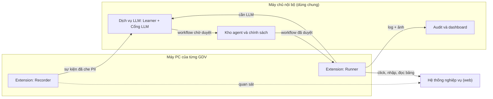
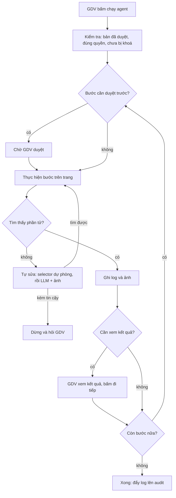

# Thiết kế PoC: Rookie Agent (agent học thao tác GDV trên web)

Tài liệu này là nguồn thiết kế duy nhất của PoC. Bản đầy đủ có sơ đồ ở dạng Mermaid để xem trực tiếp trên GitHub hoặc VS Code.

## 1. Mục tiêu và phạm vi

PoC chứng minh một agent có thể học thao tác của giao dịch viên (GDV) trên web qua vài lần làm mẫu, rồi tự chạy lại và được kiểm soát từng bước.

- **Trong phạm vi:** ứng dụng web, dữ liệu giả lập (synthetic), chỉ đọc dữ liệu. Bài toán demo là đối chiếu 2 báo cáo cuối ngày.
- **Ngoài phạm vi:** ứng dụng desktop, kết nối hệ thống thật, thao tác ghi tiền, tự động phê duyệt.

Nguyên tắc thiết kế:

1. Học từ làm mẫu, không viết mã riêng cho từng quy trình.
2. Ghi theo ngữ nghĩa (id, label, role), không dùng toạ độ.
3. Con người chịu trách nhiệm cuối: mỗi bước cấu hình được là tự chạy, dừng xem hoặc xin duyệt.
4. Ưu tiên API/MCP khi có; thao tác trên màn hình là phương án dự phòng.
5. Che dữ liệu nhạy cảm ngay trên máy người dùng, trước khi gửi đi.

### Yêu cầu nguồn (từ cuộc họp)

- Người nghiệp vụ tự tạo agent cho việc hàng ngày, không cần IT viết API từng việc.
- Học từ làm mẫu: làm khoảng 10 giao dịch, agent sinh cách chạy tự động, chạy thử, người xác nhận đúng thì lưu vào kho.
- Khác RPA truyền thống: có bước tư duy (so sánh, phát hiện lệch, giải thích).
- Kiểm soát từng bước, con người chịu trách nhiệm cuối, có môi trường test, không tự động phê duyệt hay chuyển tiền.
- Chia sẻ tri thức mặc định trong đơn vị, có chế độ riêng tư; agent của người giỏi được chấm điểm để người khác dùng lại.
- Mô hình triển khai phân tán: Runner chạy trên từng máy PC. Giai đoạn này chỉ làm web, các ứng dụng khác dự kiến chuyển về web.

## 2. Kiến trúc tổng thể

Hai nơi: mỗi máy PC của GDV có Recorder và Runner nằm trong extension; máy chủ nội bộ dùng chung giữ dịch vụ LLM, kho agent, chính sách và audit.



Vòng đời của một agent:

1. **Ghi:** GDV làm mẫu, Recorder gửi sự kiện đã che PII lên máy chủ.
2. **Học:** Learner sinh workflow từ các lần ghi; GDV xem và sửa.
3. **Thử:** workflow chạy ở sandbox; đúng như mong đợi thì lưu vào kho agent.
4. **Duyệt:** GDV xác nhận agent của mình; muốn chia sẻ cho người khác thì cần thêm người duyệt nghiệp vụ.
5. **Chạy:** máy GDV giữ bản đã duyệt và Runner chạy ngay tại máy, từng bước có kiểm soát.
6. **Giám sát:** log, ảnh và điểm chất lượng được đẩy lên audit để cải tiến agent.

## 3. Extension: Recorder

Extension Manifest V3 ghi thao tác của GDV trên trang web và gửi về server nội bộ dưới dạng sự kiện có cấu trúc.

| Thành phần | Vai trò |
| --- | --- |
| Content script | Bắt click, nhập, chọn, submit; xử lý iframe cùng domain và shadow DOM; dùng MutationObserver cho trang SPA đổi nội dung không đổi URL |
| Service worker | Gom sự kiện theo phiên, che PII, gửi về server, giữ trạng thái đang ghi |
| Side panel | Bắt đầu / Dừng, gắn nhãn bước, xem lại và xoá bước ghi nhầm |
| Network observer | Ghi endpoint và mã kết quả của các API gọi sau mỗi hành động (webRequest, chỉ quan sát) |

**Cách ghi phần tử.** Mỗi phần tử lưu nhiều selector dự phòng theo thứ tự ưu tiên: id ổn định, name, label hoặc aria-label, role kèm text, vị trí tương đối trong form. Id sinh ngẫu nhiên bị loại bằng nhận dạng mẫu chuỗi.

**Quyền trong manifest.** `activeTab`, `scripting`, `storage` và `webRequest` giới hạn ở các host nội bộ. Chỉ ghi khi GDV bấm Bắt đầu và luôn hiện biểu tượng đang ghi.

## 4. Định dạng dữ liệu

Hai định dạng JSON nối các thành phần: **event** (một hành động đã ghi) và **workflow** (quy trình đã tổng quát hoá). JSON Schema nằm trong `schemas/` và là hợp đồng giữa extension và server.

### 4.1 Event (Recorder sinh ra)

```json
{
  "schema_version": 1,
  "session_id": "s-0142",
  "seq": 7,
  "ts": "2026-11-12T09:15:03Z",
  "type": "click",
  "url": "/baocao/cuoingay",
  "target": {
    "selectors": ["#btn-search", "button[name=search]", "role=button[name='Tìm kiếm']"],
    "label": "Tìm kiếm",
    "tag": "button"
  },
  "value": null,
  "value_class": null,
  "api_calls": [{"method": "GET", "path": "/api/report", "status": 200}],
  "screenshot": "s-0142/007.png"
}
```

`type` thuộc: `click`, `input`, `select`, `navigate`, `submit`.

### 4.2 Quy tắc lưu giá trị nhập

Learner cần so sánh giá trị giữa các lần ghi để nhận ra tham số, nhưng dữ liệu nhạy cảm không được rời máy. Vì vậy trường được phân loại ngay trong extension:

| Loại trường | Ví dụ | Cách lưu trong event |
| --- | --- | --- |
| Bỏ qua | mật khẩu, OTP | Không ghi sự kiện giá trị. |
| Nhạy cảm | số tài khoản, CCCD, tên, số tiền | `value` = `null`, `value_class` = loại (ví dụ `account_number`). Learner luôn coi là tham số. |
| Không nhạy cảm | ngày, loại báo cáo, tuỳ chọn trong dropdown | `value` lưu giá trị thật để Learner so sánh giữa các lần ghi. |

Danh sách loại trường nằm trong cấu hình của extension (theo `name`, `label`, `type`), mặc định là nhạy cảm khi chưa phân loại được.

### 4.3 Workflow (Learner sinh ra)

```json
{
  "schema_version": 1,
  "id": "doi-chieu-cuoi-ngay",
  "version": 3,
  "status": "approved",
  "inputs": [
    {"name": "ngay", "type": "date"},
    {"name": "nguong_lech", "type": "number", "default": 1000}
  ],
  "steps": [
    {"id": "open_a", "action": "click", "target": {"selectors": ["#tab-a", "text=Báo cáo A"]}, "risk": "read", "mode": "auto"},
    {"id": "set_date_a", "action": "select", "target": {"selectors": ["#f-date", "label=Ngày báo cáo"]}, "value": "{ngay}", "risk": "read", "mode": "auto"},
    {"id": "search_a", "action": "click", "target": {"selectors": ["#btn-search", "text=Tìm kiếm"]}, "risk": "read", "mode": "auto"},
    {"id": "extract_a", "action": "extract_table", "target": {"selectors": ["#tbl-report"]}, "save_as": "bao_cao_a", "risk": "read", "mode": "auto"},
    {"id": "compare", "action": "compare", "inputs": ["bao_cao_a", "bao_cao_b"], "key": "id", "tolerance": "{nguong_lech}", "risk": "read", "mode": "review"},
    {"id": "save_report", "action": "save", "risk": "write", "mode": "approve"}
  ]
}
```

- `action` của PoC: `goto`, `click`, `fill`, `select`, `extract_table`, `compare`, `save`.
- `status`: `draft` → `tested` → `approved`.
- `risk` (`read` / `write` / `money`) do **luật cố định** gán, không để LLM tự quyết: bước gọi API ghi hoặc API tiền được gắn `write` hoặc `money`.
- `mode` (`auto` / `review` / `approve`): xem mục 6.

## 5. Learner

Learner biến 3 đến 10 lần ghi thành một workflow có tham số: so sánh các lần làm với nhau, rồi hỏi LLM ở những chỗ còn mơ hồ.

1. **Chuẩn hoá:** gộp nhiều lần gõ phím thành một thao tác điền, bỏ click trùng.
2. **Căn chỉnh các phiên:** bước giống nhau ở mọi lần là bước cố định; giá trị khác nhau thành tham số.
3. **LLM diễn giải:** nhận bản tóm tắt các phiên kèm ảnh màn hình để đặt tên bước, nêu ý định, suy ra kiểu tham số và phát hiện bước có điều kiện.
4. **Gán mức rủi ro bằng luật** (xem 4.3).
5. **Người dùng duyệt:** xem workflow và form đầu vào sinh ra, sửa nếu cần.
6. **Chạy thử:** 1 đến 3 giao dịch mẫu ở sandbox; đúng như mong đợi thì lưu vào kho agent.

Giới hạn: từ vài lần ghi chỉ tổng quát hoá được các biến thể đã thấy. Gặp nhánh chưa từng thấy, agent dừng và hỏi GDV thay vì đoán.

Bản PoC đầu tiên của Learner dùng `RuleBasedClient` (bước 1, 2, 4 bằng luật; bước 3 để sau khi có LLM thật).

## 6. Runner và kiểm soát từng bước

Runner là một phần của extension, chạy ngay trên máy của từng GDV trong phiên đăng nhập của chính họ, và mỗi bước có một chế độ kiểm soát do người dùng cấu hình trong giới hạn mà mức rủi ro cho phép.

| Chế độ | Hành vi | Dùng cho |
| --- | --- | --- |
| `auto` | Chạy liền, không dừng | Bước chỉ đọc dữ liệu |
| `review` | Chạy xong dừng để người xem kết quả rồi cho đi tiếp | Nhập liệu, kết quả đối chiếu |
| `approve` | Dừng trước khi chạy, chờ duyệt (maker-checker) | Bước ghi dữ liệu, giao dịch tiền |

Quy tắc cứng: bước `money` không thể đặt `auto`; bước `write` luôn là `approve`. Mọi lần chạy có nút Dừng khẩn và ghi log từng bước kèm ảnh màn hình. Workflow mới luôn chạy ở sandbox trước khi được phép chạy ngoài.

**Tự sửa khi giao diện đổi (self-healing).** Khi selector không còn khớp:

1. Thử lần lượt các selector dự phòng đã ghi.
2. Nếu vẫn lỗi, LLM nhận ảnh màn hình và mô tả phần tử để tìm phần tử tương đương.
3. Độ tin cậy dưới ngưỡng thì dừng và hỏi người dùng.
4. Sửa thành công thì đề xuất cập nhật workflow; chỉ lưu khi người dùng duyệt.



**Mô hình phân tán trên từng máy PC.**

| Vấn đề | Cách xử lý |
| --- | --- |
| Cài đặt và cập nhật | Runner nằm trong extension, phát hành và cập nhật qua kho extension nội bộ hoặc chính sách của IT; máy GDV không cần cài thêm Python hay trình điều khiển trình duyệt |
| Phát workflow xuống máy | Máy chỉ nhận bản đã duyệt từ kho agent, kiểm tra version và chữ ký trước khi chạy, rồi giữ bản sao trên máy |
| Quyền và định danh | Chạy trong phiên đăng nhập của chính GDV; mỗi lần chạy ghi mã người dùng, mã máy và version agent; không dùng tài khoản chung |
| Điều khiển tập trung | Chính sách (agent nào, vai trò nào được chạy) và lệnh khoá agent được kéo về máy định kỳ; bị khoá thì Runner dừng ở bước kế tiếp |
| Gọi LLM | Máy không gọi LLM trực tiếp, chỉ qua cổng LLM nội bộ và chỉ gửi dữ liệu đã che PII |
| Xử lý dữ liệu | Trích xuất bảng và tính đối chiếu ngay trên máy; chỉ các dòng lệch đã che mới gửi lên khi cần LLM giải thích |
| Mất kết nối | Bước cần máy chủ hoặc LLM thì dừng an toàn và báo GDV; log và ảnh được đệm trên máy, đẩy lên khi có mạng lại |
| Kiểm thử | Workflow mới chạy thử bằng Playwright trên sandbox ở máy chủ trước khi được phát xuống máy |

## 7. Bước tư duy: đối chiếu 2 báo cáo

Ngoài lấy dữ liệu, agent so sánh theo rule của người dùng và giải thích chênh lệch.

- **Chia việc giữa mã và LLM.** Phần tính toán chắc chắn do mã làm: ghép dòng theo khoá (mã giao dịch, số tài khoản), cộng tổng, tìm dòng thiếu hoặc lệch số. LLM chỉ làm phần cần phán đoán: phân loại nguyên nhân lệch, gợi ý cách xử lý, soạn ghi chú.
- **Rule do người dùng nhập bằng ngôn ngữ tự nhiên**, ví dụ "lệch dưới 1.000 đồng do làm tròn thì bỏ qua". Hệ thống chuyển rule thành tham số của bước đối chiếu (ví dụ `nguong_lech`) và hiển thị lại để người dùng xác nhận.
- **Kết quả đầu ra:** bảng lệch gồm khoá, giá trị hai bên, chênh lệch, nguyên nhân dự đoán và độ tin cậy; kết luận khớp hoặc không khớp (không khớp thì dừng ở chế độ `review`); toàn bộ bước tính được lưu lại để kiểm tra lại, không chỉ lưu kết luận của LLM.

## 8. Kho agent, chấm điểm và chia sẻ

| Thuộc tính | Nội dung |
| --- | --- |
| Version | Mỗi lần sửa tạo version mới, quay lại được bản cũ |
| Điểm | Tỷ lệ chạy đúng, số bước phải sửa tay, thời gian tiết kiệm so với làm thủ công |
| Chia sẻ | Riêng tư, nhóm hoặc toàn đơn vị; mặc định chia sẻ trong đơn vị, có chế độ riêng tư |
| Clone | Người khác sao chép agent và chỉnh rule theo cách làm của mình; bản gốc không đổi |

**Tri thức hai tầng.** Tầng cá nhân (rule và ghi nhớ riêng của từng người) tách khỏi tầng chung. Phản hồi sửa lỗi của người dùng chỉ đi vào tầng chung sau khi người sở hữu xác nhận và có người duyệt nghiệp vụ. Cách này tránh tình huống hai người làm khác nhau mà hệ thống không biết học theo ai.

## 9. Bảo mật, che PII và audit

| Lớp | Biện pháp |
| --- | --- |
| Thu thập | Chỉ ghi khi bấm Bắt đầu, có biểu tượng đang ghi; bỏ qua mật khẩu và OTP; giá trị nhạy cảm không lưu (4.2) |
| Che PII | Số tài khoản, CCCD, tên, số tiền được thay bằng mã giữ chỗ trước khi gửi; ảnh màn hình được che vùng nhạy cảm |
| Truyền và lưu | Kênh mã hoá về server nội bộ; LLM chạy on-prem hoặc trong vùng mạng được duyệt |
| Quyền | Agent chạy dưới quyền của chính người dùng; không có tài khoản dùng chung |
| Audit | Log từng bước: ai chạy, agent version nào, API nào, kết quả, người duyệt, ảnh màn hình |
| Rủi ro | Phân cấp `read` / `write` / `money`; bước `money` luôn cần duyệt trước; PoC không có bước ghi tiền |

**Minh bạch với GDV.** Nói rõ mục đích là tạo agent hỗ trợ công việc của chính họ, không dùng để giám sát hay chấm điểm cá nhân, và có cơ chế xoá bản ghi của mình.

**Cần xác nhận với bộ phận an toàn thông tin:** chính sách cài extension trên máy giao dịch, vị trí đặt LLM, thời gian lưu log và ảnh màn hình.

## 10. Mock site và kịch bản demo

Demo chạy trên một web giả lập (FastAPI kèm trang HTML đơn giản) mô phỏng hệ thống nghiệp vụ, với dữ liệu synthetic.

**Mock site gồm:** trang đăng nhập, Báo cáo A (đối chiếu từ hệ thống nguồn 1), Báo cáo B (hệ thống nguồn 2), mỗi báo cáo có bộ lọc ngày và bảng kết quả xuất được. Dữ liệu sinh sẵn có một số dòng lệch cố ý (lệch số, thiếu dòng, lệch do làm tròn). Có một công tắc "giao diện mới" đổi id và vị trí nút để thử self-healing.

**Kịch bản khoảng 10 phút:**

1. Bật record trong side panel, làm đối chiếu 3 lần với các ngày khác nhau.
2. Bấm Học: hiện workflow sinh ra, các bước và form đầu vào.
3. Chạy với ngày mới: agent tự chạy các bước đọc, dừng ở bước đối chiếu chờ xem kết quả.
4. Xem bảng lệch kèm nguyên nhân dự đoán; sửa rule làm tròn rồi chạy lại.
5. Bật công tắc đổi giao diện: agent tự tìm lại nút và chạy tiếp, ghi nhận đề xuất cập nhật workflow.
6. Mở dashboard: thời gian so với làm thủ công, tỷ lệ bước đúng, audit trail.
7. Người dùng thứ hai clone agent và chỉnh rule theo cách làm của mình.

`docs/demo-reference.html` là bản mô phỏng tương tác một file của kịch bản này, dùng để tham khảo hành vi và giao diện.

## 11. Kế hoạch, KPI và rủi ro

PoC làm trong 3 tuần với ba cổng kiểm (chi tiết việc và tiêu chí nghiệm thu ở `docs/tasks.md`).

| Cổng | Tuần | Điều kiện qua cổng |
| --- | --- | --- |
| Gate 1: ghi được | 1 | 3 lần làm mẫu được ghi đủ và xuất được event JSON |
| Gate 2: chạy lại đúng | 2 | Workflow sinh ra chạy đúng với dữ liệu ngày mới |
| Gate 3: demo đủ kịch bản | 3 | 7 bước trong mục 10 chạy được, kèm số đo thời gian và độ đúng |

Các tiêu chí qua cổng là đề xuất từ kịch bản demo, cần thống nhất với khối vận hành.

**Chỉ số đo**

| Chỉ số | Cách đo |
| --- | --- |
| Bước tự chạy đúng | Số bước chạy đúng không cần sửa tay trên tổng số bước, qua các lần chạy với dữ liệu ngày mới |
| Phát hiện dòng lệch | Tỷ lệ dòng lệch cố ý trong dữ liệu mock mà agent tìm ra đúng |
| Tự sửa khi đổi giao diện | Số lần tự tìm lại đúng phần tử trên tổng số lần đổi giao diện thử |
| Thời gian | Thời gian agent chạy so với GDV làm thủ công cùng quy trình |

**Rủi ro và hướng xử lý**

| Rủi ro | Hướng xử lý |
| --- | --- |
| Tổng quát hoá kém từ vài lần ghi | Ghi nhiều biến thể; gặp nhánh chưa thấy thì agent dừng và hỏi GDV |
| Máy giao dịch không cho cài extension | Xin duyệt chính sách sớm; chạy PoC trên máy thử nghiệm trong lúc chờ |
| Ứng dụng nghiệp vụ không phải web | PoC giới hạn ở web theo định hướng đã thống nhất; các ứng dụng khác dự kiến chuyển về web |
| Vị trí đặt LLM chưa chốt | Xác nhận với bộ phận an toàn thông tin; PoC chỉ dùng dữ liệu synthetic |

**Câu hỏi mở**

- Ngưỡng đạt cho từng chỉ số (cuộc họp chưa nêu).
- Quy trình thật đầu tiên để thử sau PoC: cuộc họp nhắc đối chiếu cuối ngày và hành trình chuyển tiền ngoại tệ.
- Ai duyệt agent trước khi vào kho chung.
- Chính sách cài extension và vị trí đặt LLM trong ngân hàng.
