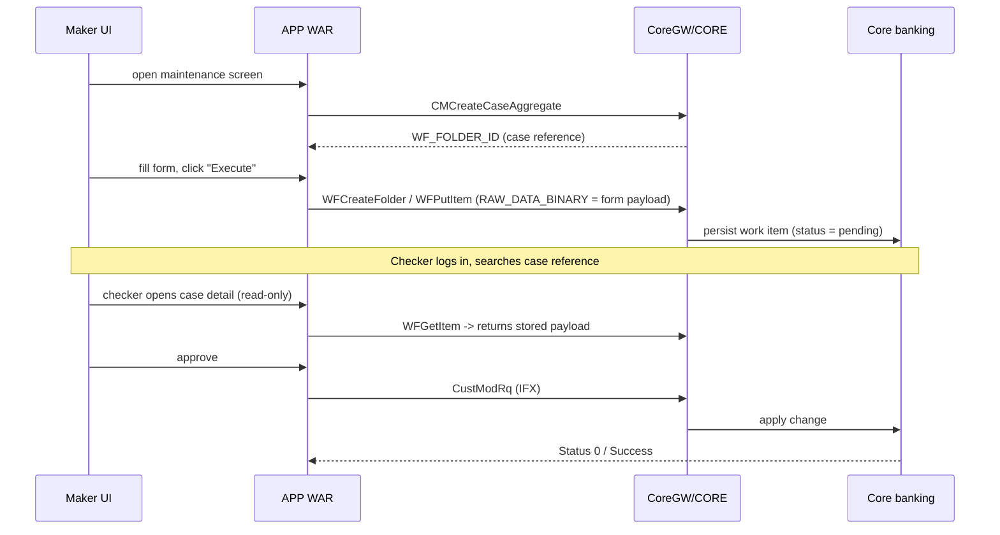
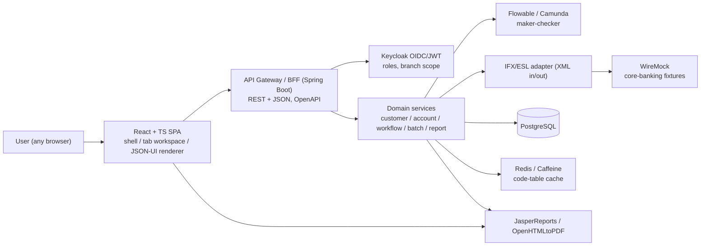

# APP (APP) — Technology Overview & Blueprint for a Modern Clone

> Source: `app` workspace (Hệ thống quầy APP, Ngân hàng X build)
> Build stamp: `Rel 14.1 BANKPRODMAINT.dev + CORE` — see `source/app.properties:4`

---

## 1. What the application is

`app` is **Hệ thống quầy APP (APP)** — a bank **front-office desktop**
combining CRM, account servicing, teller transactions, batch processing and maker–checker
workflow, delivered as a J2EE web application.

It is **not a website**. It is a *thick web desktop*: a fixed-size popup window
(1024x768) hosting a frameset shell, a GWT "desktop" layer, and thousands of legacy
JSP/JS screens rendered from **XML + XSLT**.

### Functional modules found in `websource/`

| Area | Modules |
|---|---|
| Customer | locate, profile, contacts, contact history, household/relationships, enhanced KYC, blacklist |
| Accounts | account notebook, account opening (AO), deposit / loan / CD / savings specifics, account transfer, related links |
| Payments | funds transfer, ACH, direct deposit, standing/scheduled transfers, payroll |
| Cards | order card, card issuance batch, credit card servicing |
| Checks | check orders, check stock/consignment, stop payments & holds |
| Lending | loan disbursement, loan calculators, what-if calculator, frequency calculator |
| Sales & Marketing | campaigns, referrals, opportunities, best practices, needs assessment, action plans, product presentation, saleskit |
| Operations | batch upload, workflow cases, inbox/messaging, attachments/ECM, e-forms + digital signature, PDF printing, reporting |
| Admin | users, roles, permissions, locations, workstations, code tables, rate sets, products |
| Audit | event history, journal entries, statistics |

---

## 2. Technology inventory (as-is)

### 2.1 Runtime & language

| Concern | Technology | Evidence |
|---|---|---|
| Language / JVM | Java 6 (`jdk1.6.0_25`) | `.classpath:4` |
| Web spec | Servlet/JSP 2.4, J2EE | `websource/WEB-INF/web.xml:2` |
| Containers | Tomcat 5.5 (dev), WebSphere + JBoss descriptors (prod) | `.classpath:43`, `jboss-web.xml`, `ibm-web-bnd.xmi` |
| Packaging | `app.war` / `.ear` + `appstatic.tar.gz` | `build.jenkins/build.xml:447` |
| IDE | Eclipse WTP + Google Eclipse Plugin (GDT) | `.project:49` |
| Build | Apache Ant 1.7.1, Jenkins, Artifactory | `Jenkinsfile:9` |
| VCS | SVN (ClearCase historically) | `.svn/`, `doc/Running_Local_APP_Builds.doc` |

### 2.2 Server-side frameworks

- **Spring 2.5.6** — IoC, `DispatcherServlet`, `ContextLoaderListener`;
  bean files loaded by wildcard `classpath*:/appbeans_*.xml`
  (`web.xml:406`, `source/appbeans_app.xml`)
- **Spring Web Services 1.5.9** — `WebServiceTemplate` for SOAP to core (`appbeans_app.xml:46`)
- **Apache Struts 1.2.4** — legacy `*.do` controller (`WEB-INF/struts-config.xml:33`)
- **Hibernate 3** + `*.hbm.xml` mappings for event history (`source/eventHistory-queries.hbm.xml`)
- **JDBC / Oracle** — `jdbc:oracle:thin`, `ojdbc14`, **c3p0** pool, JNDI `jdbc/APPDB` (`appbeans_app.xml:13`)
- **JSP + JSTL 1.1 + Tiles 2.0.6 + custom taglibs** (`tp`, `log`, `jwr`) (`websource/common.jsp:1`)
- **Velocity 1.7 + velocity-tools 2.0** (`conf/velocity-tools.xml`)
- **Xalan 2.7.1 / XSLTC** — server-side XSLT engine (`web.xml:434`)
- **JAWR 3.1.2** — JS/CSS bundling, compression, cache-busting (`source/jawr.properties`, `web.xml:31`)
- **Log4j 1.2.16 + SLF4J 1.6.3**
- **EhCache 1.7.1 / JCS 1.2.5** — caching
- **Gson 2.3, json-lib 2.3** — serialization
- **Apache POI 3.7** — Excel
- **iText 2.1.7 / 5.4.2, JasperReports 5.6.1, DynamicJasper 5.0.2, Groovy 2.0.1** — PDF & reports
- **OWASP ESAPI 2.1.0** — input validation/encoding (`APPdesktop.jsp:13`)
- **ldapjdk** — LDAP/OVD access
- **BouncyCastle 1.51, xmlsec 1.5.7, OpenSAML 2.6.4, xmltooling 1.4.4, openws 1.5.4** — crypto & SAML
- **java-jwt 2.0.1** — JWT tokens
- Vendor proprietary: **fw-core / fw-security / fw-theme 2.0.0**, **lib-int 2.0.0**, **rbacCore 1.2.5**,
  **libCore/libSSO/libBoc**, **CoreGW/CORE** jars (`coreFramework`, `coreServicesAPPVo`, `coregw-xbo-ifx20`)

Full dependency list: `build.jenkins/build.properties`.

### 2.3 Client-side

**GWT 2.3.0** (with **Gin 1.5.0 / Guice 3.0-rc2**, **AutoBean**, GWT-RPC, GWT I18N) for the shell
and a set of modules:

| GWT module | Entry point | Purpose |
|---|---|---|
| `app.gwt.mainapp.MainApp` | `MainApp` | desktop shell, session timeout, JS bridge |
| `app.gwt.core.APPCoreApp` | — | shared core, theme, i18n (`en`, `vi`) |
| `app.gwt.checkorder.CheckOrder` | `CheckOrderModule` | check ordering |
| `app.gwt.batch.BatchUpload` | `BatchUpload` | batch file upload |
| `app.gwt.forms.Forms` | `FormsInvoker` | e-forms |
| `app.gwt.eventhistory.EventHistoryApp` | `EventHistoryApp` | audit trail |
| `app.gwt.signature.SignatureVerify` | `SignatureVerify` | digital signature verify |
| `app.gwt.dialogUtils.DialogUtils` | `DialogUtils` | shared dialogs |
| `app.gwt.remotelaunch.RemoteLaunch` | `RemoteLaunchModule` | cross-app launch |
| `appf.industrytype.IndustryTypeAPP` | — | industry type picker |

Key constraints:

- `user.agent = ie6, ie9` only (`MainApp.gwt.xml:10`)
- Locales `en`, `vi` (`APPCoreApp.gwt.xml:6`)
- GWT <-> legacy JS bridge via **JSNI** native methods (`MainApp.java:23`)

**Legacy JS layer** — ~150 hand-written ES3 files in `websource/js/`, several 200-300 KB
(`MiscScript.js`, `optionActions.js`, `commonForm.js`, `commonAOTxn.js`, `commonTitle.js`):

| File | Role |
|---|---|
| `AppTransaction.js` | bespoke OOP (`APP.extend`), `AppTransServer` / `AppClassLoader` request builders |
| `BSTransMgr.js` | `BSISTransaction` — build/execute/parse core transactions |
| `ServiceManager.js` | service call + paging + caching per context (global/session/window) |
| `HTTPConnection.js` | XHR wrapper with Java-applet fallback |
| `XSLTemplateFactory.js` | caches compiled client-side XSLT (`Msxml2.XSLTemplate` ActiveX) |
| `cache.js`, `cacheWrappers.js`, `gwtCache.js` | client-side data cache |
| `tableview.js`, `ListView.js`, `dhtmlTreeview.js`, `comboBox.js`, `dropdown.js`, `vmlTabs.js`, `monthCalendar.js` | widget library |
| `DataFormatter.js`, `dateSupport.js`, `currencySupport.js`, `numberSupport.js` | formatting |
| `permissions.js`, `optionActions.js` | role/permission-driven UI |
| `localizationSupport.js`, `Lookup_*.js` | i18n |
| `dirtyDataSupport.js`, `ValueChangeTracker.js`, `modifiedFieldIdentifier.js` | form change tracking |
| `StatisticsManager.js`, `Logger.js`, `TimeMeter.js` | client telemetry |

**View engine = XML + XSLT.** The server returns XML; the browser transforms it into HTML
using ~600 `.xsl` files in `websource/XSL/` (`ifxaccountdetail.xsl` alone is 60 KB).

**Desktop shell = frameset** (`websource/desktop/desktop_frameset.htm:5`) with frames
`toolbar`, `rtop`, `rbottom`, `rhidden`, `fiApplet`, plus pervasive cross-frame `top.*` access.

**Local device access** via Java applets, ActiveX, VBScript, `.htc` behaviors and CAB installs:
`websource/CABS/` (`AppCommAPI.CAB`, `AppInterface.cab`, `MSComCtl.CAB`, `wspellam.cab`, `wkname.cab`),
`js/appControl.htc`, `js/*.vbs`, `desktop/compressionApplet.jsp`, `desktop/fiApplet.jsp`.

**Browser support: Internet Explorer only.**

### 2.4 Security & identity

| Layer | Implementation |
|---|---|
| Web SSO | SAML 2.0 with ADFS — `com.bank.sso.*`, `conf/sso_idp_metadata.xml`, `conf/appbeans_sso.xml:15` |
| Directory auth | LDAP / Oracle OVD — `LDAPLoginServlet.java`, `appbeans_app.xml:95` |
| Legacy auth | RBAC (Vendor Roles & Permissions) username/password in APPDB |
| Authorization | RBAC RBAC: user -> role -> LOB -> applet/feature permission with min/max limits |
| API token | Short-lived JWT filter on RPC endpoints (`web.xml:302`, `app.properties:86`) |
| Filter chain | `SSOFilter` -> `JWTTokenValidateFilter` -> `GZIPRequestFilter` -> `ThreadLocalFilter` -> `LoginFilter` |
| Input validation | ESAPI `validator().getValidInput(...)` in JSPs |
| Session | `session-timeout 260` min + client-side idle lock prompt (`web.xml:442`, `MainApp.java:38`) |
| Crypto | AES (`AppEncryptionAlgorithm=AESF`), BouncyCastle, `SPSignDoc` for digital signatures |
| Service allow-list | `NOT_ALLOWED_SERVICES` blacklist in `app.properties:93` |

Auth types are switchable via one property: `SSO` | `LDAP` | `OVD` | `RBAC` (`conf/appbeans_sso.xml:10`).

---

## 3. Architecture (as-is)

```mermaid
flowchart LR
  subgraph Browser["IE browser - APP desktop shell"]
    SHELL["Frameset shell<br/>toolbar / rtop / rbottom / rhidden / fiApplet"]
    GWT["GWT MainApp<br/>session mgmt, dialogs, RPC"]
    JS["Legacy JS framework<br/>ServiceManager, BSTransMgr, AppTransaction"]
    XSLT["Client XSLT (ActiveX)<br/>websource/XSL/*.xsl"]
    APPLETS["Java applets / ActiveX<br/>print, scanner, host emulation"]
    SHELL --- GWT --- JS --- XSLT
    SHELL --- APPLETS
  end

  subgraph WAR["app.war (Servlet 2.4)"]
    F["Filter chain<br/>SSO - JWT - GZIP - ThreadLocal - Login"]
    subgraph CTRL["Controllers"]
      SPR["Spring MVC DispatcherServlet<br/>*.fisglobal, /AppService/*, *.batch"]
      STRUTS["Struts 1 ActionServlet (*.do)"]
      RPC["GWT-RPC / CAFDispatcherServlet<br/>platformServlet"]
      SERV["Custom servlets: AppTransServer, AppClassLoader,<br/>FacadeServlet, AppIntelliSync, APPPDFServer, AppUploadServlet"]
    end
    SVC["Service layer<br/>RemoteModelService, APPXBO, CommonDataService,<br/>RestService, CardServices"]
    SEC["fw-security / RBAC / SAML / LDAP"]
    RPT["JasperReports + iText + POI"]
    CACHE["EhCache / JCS<br/>Configuration/cache.xml"]
  end

  subgraph CORE["Bank backend"]
    CORE["Vendor CoreGW/CORE adapter<br/>/coregw/services/esl/action/{Service}<br/>/coregw/services/ifx15/raw<br/>SOAP IFXService2Port"]
    COREAPP["Vendor Profile / Premier core (ESL + IFX XML)"]
    DB[("Oracle jdbc/APPDB")]
    REST["Satellite REST/OAuth2 apps<br/>ITS, ACH, CPM, EFAST, Kiosk, Register, ECM"]
    IDP["ADFS / LDAP / OVD"]
  end

  Browser -->|HTTP POST XML/JSON| F --> CTRL --> SVC
  SVC -->|IFX/ESL XML| CORE --> COREAPP
  SVC -->|REST + OAuth2| REST
  SVC --> DB
  SEC --> IDP
  CTRL --> RPT
  SVC --> CACHE
```

### 3.1 Servlet / endpoint map

| Endpoint | Servlet | Purpose |
|---|---|---|
| `*.fisglobal` | `fw-security` (Spring MVC) | pre/post authentication, role selection |
| `/APPService/*`, `/AppService/*` | `cafController` (Spring MVC) | service calls |
| `*.batch` | `cafController` | batch upload controllers |
| `*/platformServlet` | `PlatformServiceImpl` | GWT-RPC |
| `*.do` | Struts `ActionServlet` | legacy `DesktopAction` |
| `/AppTransServer` | `AppTransServer` | main XML transaction gateway |
| `/AppClassLoader` | `AppClassLoader` | dynamic screen/config loading |
| `/FacadeServlet` | `FacadeServlet` | unified facade |
| `/AppIntelliSync` | `AppIntelliSync` | background data sync |
| `/APPPDFServer`, `/APPPDFTransServer`, `/APPPDFPrintForms` | PDF servlets | form printing |
| `/AppUploadServlet`, `/AppBulkCampaignUploadServlet` | upload | file ingest |
| `/AppSaveFileAs` | download | file export |
| `/AppHeartbeat`, `/AppStatistics`, `/AppSnoop`, `/AppLogError` | ops | monitoring/diagnostics |
| `/jsJawrPath/*`, `/cssJawrPath/*` | JAWR | bundled JS/CSS |
| `/sso/acs`, `/sso/logout` | `SSOAcsServlet` | SAML assertion consumer |
| `/auth/login` | `LDAPLoginServlet` | LDAP login |

### 3.2 Two message styles (the core integration contract)

**1. ESL / "APP action" RPC** — a flat XML envelope naming an action plus its fields,
POSTed to the transaction servlet, which forwards to
`http://<core-host>/coregw/services/esl/action/<ACTION>`.

```xml
<APP>
  <action name="SMValidateUser">
    <LOGON_NAME>...</LOGON_NAME>
    <LOGON_PASSWORD>...</LOGON_PASSWORD>
    <WORKSTATION_NAME>...</WORKSTATION_NAME>
  </action>
</APP>
```

Example: `websource/Configuration/AppApp.xml:31`.

Every action and its input/output fields are declared in
**`websource/Configuration/service.xml`** (~197 KB, hundreds of actions:
`SMValidateUser`, `SMGetRoles`, `SMGetUser`, `CMCreateCaseAggregate`, `WFCreateFolder`,
`RFGetProduct`, `TNGetTran`, `LSCalcLOC`, ...). This file is effectively the **API schema**.

**2. IFX (IFXForum banking standard) XML** — request/response pairs against
`/coregw/services/ifx15/raw`:

```xml
<IFX xmlns="http://www.ifxforum.org/IFX_150">
  <SignonRq>
    <SessKey>...</SessKey>
    <ClientDt>2026-10-13T09:38:47.000228+07:00</ClientDt>
    <CustLangPref>en_US</CustLangPref>
    <ClientApp><Org>com.vendor</Org><Name>A112_APP</Name><Version>1.0</Version></ClientApp>
  </SignonRq>
  <BaseSvcRq Id="ID000001">
    <RqUID>...</RqUID>
    <SPName>com.vendor.core.PRF</SPName>
    <ns1:CustInqRq xmlns:ns1="http://www.vendor.com/core/ctg/services/cust/custinq/v2_3">
      <CustId><SPName>com.vendor.core.PRF</SPName><CustPermId>100000020</CustPermId></CustId>
    </ns1:CustInqRq>
  </BaseSvcRq>
</IFX>
```

Documented request/response fixtures for `CustInqRq`, `PartyAcctRelInqRq`, `KycScoreRq`,
`CustAddRq`, `CustModRq` are in `.vsdp-specs/_text/vsdp_docs_DacTaAPP.docx.md`
(lines 24, 328, 333, 337, 346).

A third style exists for satellite apps: **REST + OAuth2** (`RestService` bean,
`appbeans_app.xml:101`) and **JSON** (`isJson` flag on `RemoteModelService`).

### 3.3 Metadata-driven UI (the key design idea)

Screens are largely **generated from configuration**, not hand-coded:

| Config file | Controls |
|---|---|
| `Configuration/cache.xml` | which transactions are global caches, `ROOT_ELEMENT`, `XSL_TEMPLATE`, sort/filter |
| `Configuration/notebooks.xml` | tab composition of each "notebook" (screen), per role/product |
| `Configuration/options.xml` + `optionImages.xml` | toolbar/option tree per role |
| `Configuration/globals.xml` | global defaults |
| `Configuration/locales.xml`, `multiLangTrans.xml` | language tables |
| `Configuration/reportsConfig.xml` | report registry (~132 KB) |
| `Configuration/versionConfiguration.xml` | feature/version gating |
| `conf/views.properties` | Spring MVC `controller.method.state.url` -> view |
| `conf/appbeans_*.xml` | service bean wiring |
| `websource/XSL/*.xsl` | actual HTML rendering of each XML response |
| `source/forms.xml`, `conf/appbeans_forms.xml` | e-form processors (merge/print/signature) |

### 3.4 Maker–checker workflow



Every maintenance transaction mints a `WF_FOLDER_ID`, stores the form state as a `DATA_BLOB`
work item, and only executes the real IFX call on checker approval.
Reference: `.vsdp-specs/_text/vsdp_docs_DacTaAPP.docx.md:338`.

### 3.5 Batch subsystem

`upload -> parse -> per-record validation -> maker/checker -> posting -> report pair`

- Controllers: `WEB-INF/cafController-servlet.xml:17` (`PayRollBatchUpload.batch`,
  `CustomerCreationBatchUpload.batch`, `HoldBatchUpload.batch`, `DepAcctBatchUpload.batch`, ...)
- Report link labels (EN + VI): `source/tp_spring.properties:4`
- Spring wiring: `conf/appbeans_batchUpload.xml`
- UI: `websource/batch/`, GWT `BatchUpload` module
- Max upload size: `maxFileUploadSize=2048576` (`tp_spring.properties:61`)

### 3.6 Internationalization

- Server: `labels{,_vi,_es,_sp}.properties` (up to 795 KB) via Spring
  `ResourceBundleMessageSource` (`appbeans_app.xml:86`)
- Client: `Configuration/translate_{en,es,fr,vi}.js` + `js/Lookup_*.js`
- GWT: locale property `en`/`vi` with `en` fallback
- Encoding: `defaultCharEncoding=utf-8`

### 3.7 Integrations (from `source/app.properties`)

| System | URL property |
|---|---|
| WebCSR (customer service) | `PDURL` |
| WebAdmin | `WEBDURL` |
| Reconciliation | `RCURL` |
| TP Form server | `APPFURL` |
| ECM (document mgmt) | `EcmDirectUrl` |
| Digital Banking (ITS) | `DigitalBankUrl` |
| Internet Banking registration | `IBRegistrationUrl*`, `RegisterAppUrl` |
| Saleskit | `SaleskitUrl` |
| ACH | `ACHUrl` |
| EFAST | `EFASTUrl` |
| CPM | `CPMUrl` |
| Core (CORE/CoreGW) | `coreUrl` in `appbeans_app.xml:36` |
| LDAP/OVD | `appbeans_app.xml:95`, `appbeans_sso.xml:16` |

---

## 4. Blueprint for a modern clone

### 4.1 Stack mapping

| Concern | As-is (APP) | Modern replacement |
|---|---|---|
| Client | GWT 2.3 + ES3 JS + framesets + ActiveX | **React 18 + TypeScript + Vite** (or Vue 3); Ant Design / MUI for enterprise density |
| Desktop shell | frameset + popup window | SPA layout: role-based nav rail + **multi-tab workspace** (each screen a closable tab with own state) |
| View generation | XML + client XSLT | **JSON + schema-driven form/table renderer** (`@rjsf/antd` or a custom JSON-UI engine) — the single most valuable idea to copy |
| RPC | ESL XML POST + GWT-RPC | **REST/JSON** (or GraphQL) backed by an action registry mirroring `service.xml` |
| Core messages | IFX 1.5/2.0 XML | Keep IFX **only inside a mock adapter service**; expose clean JSON to the UI |
| Server | Java 6, Spring 2.5, Struts 1, Servlet 2.4 | **Spring Boot 3 / Java 17-21** (or NestJS) |
| Persistence | Oracle + Hibernate 3 + c3p0 | **PostgreSQL + JPA/Hibernate 6 + HikariCP** (H2 in-memory for demo) |
| Auth | SAML ADFS + LDAP/OVD + RBAC + JWT | **Keycloak (OIDC/SAML) + JWT**; RBAC table `user -> role -> permission(min,max)` |
| Workflow | CM/WF case engine in core DB | **Camunda / Flowable**, or a simple `case(id, status, maker, checker, payload_json)` table |
| Reports/PDF | JasperReports + iText + DynamicJasper | JasperReports (still fine) or OpenHTMLtoPDF + POI |
| Bundling | JAWR | Vite / webpack |
| Caching | EhCache / JCS | **Caffeine / Redis** |
| Logging | Log4j 1.2 | Logback + JSON appender + OpenTelemetry |
| Build/CI | Ant + Jenkins | **Maven/Gradle + GitHub Actions/GitLab CI**, Docker |
| Deploy | WAR -> Tomcat/WebSphere | Container image or Spring Boot executable jar |
| Tests | JUnit 4.4, manual | JUnit 5 + Testcontainers + Playwright + Vitest/RTL |

### 4.2 Minimum viable clone (feature slice)

1. **Login + role selection** — session carrying role, branch/location, language
2. **Desktop shell** with role-driven option tree and tabbed workspace
3. **Global cache bootstrap** — on login, fetch code tables (banks, branches, currencies,
   roles, products, message categories) once and cache client-side, exactly like
   `cache.xml` + `SMGetGlobDefs`
4. **Customer locate** by CIF / ID / name / tax ID — grid with paging + sorting
5. **Customer profile notebook** — tabs: personal info, IDs, addresses, contacts, related accounts
6. **Create CIF wizard** (2 steps) with a **KYC scoring gate** before submit
7. **Maker–checker maintenance** — edit -> case reference -> approval queue -> apply
8. **Batch upload** for one type (e.g. holds) with error/success report pair
9. **Event history / audit trail** screen
10. **PDF/print** of a form + **i18n** (en/vi)

### 4.3 Mock backend contract

| Endpoint | Behaviour |
|---|---|
| `POST /esl/{ACTION}` | Build response from an `actions.json` registry (field name, I/O, required) — direct analogue of `Configuration/service.xml` |
| `POST /ifx/raw` | Accept/return IFX envelopes for `CustInqRq/Rs`, `CustAddRq/Rs`, `CustModRq/Rs`, `PartyAcctRelInqRq/Rs`, `KycScoreRq/Rs` — reuse the real samples from `.vsdp-specs/_text/vsdp_docs_DacTaAPP.docx.md` as fixtures |
| `POST /api/{domain}/{verb}` | Clean JSON for the new UI |
| `GET /api/ui/schema/{screenId}` | JSON-UI schema replacing `notebooks.xml` + XSL |
| `GET /api/meta/codes/{table}` | Code tables replacing the global cache |

Tooling: **WireMock** (Java) or **MSW** (browser/node) or a Spring Boot stub controller.

### 4.4 Target architecture



### 4.5 Suggested repo layout

```text
app-clone/
├─ apps/
│  ├─ web/                 # React + TS + Vite
│  │  ├─ src/shell/        # layout, tabs, role nav
│  │  ├─ src/json-ui/      # schema-driven form/table engine
│  │  ├─ src/features/     # customer, account, batch, workflow, audit
│  │  └─ src/i18n/         # en.json, vi.json
│  └─ api/                 # Spring Boot BFF
│     ├─ customer/ account/ workflow/ batch/ report/
│     └─ adapter/          # IFX + ESL marshalling
├─ mocks/
│  ├─ wiremock/mappings/   # /esl/{ACTION}, /ifx/raw
│  └─ fixtures/*.xml       # real request/response samples
├─ meta/
│  ├─ actions.json         # from Configuration/service.xml
│  ├─ screens.json         # from Configuration/notebooks.xml
│  ├─ codes.json           # from Configuration/cache.xml
│  └─ options.json         # from Configuration/options.xml
└─ infra/ (docker-compose, postgres, keycloak)
```

### 4.6 What to copy vs. what to drop

**Copy (these are the durable design ideas):**

- Metadata-driven screens instead of hand-coded forms
- Per-role option/permission tree with min/max limits
- Global code-table cache loaded once at login
- Maker–checker on every maintenance action
- Batch + report-pair pattern
- Full audit / event history
- i18n-first labels
- Session idle-lock with pre-timeout prompt

**Drop:**

- Framesets and `top.*` cross-frame coupling
- ActiveX, Java applets, VBScript, `.htc`, CAB installs
- Client-side XSLT rendering
- IE-only GWT permutations
- XML as the UI transport
- Java 6 / Spring 2.5 / Struts 1 / Servlet 2.4
- Log4j 1.2
- Plaintext credentials in properties files
  (`source/app.properties:79`, `conf/appbeans_sso.xml:20` — use a secret store)

### 4.7 Effort estimate

A faithful mock of the 10-item MVP with a JSON-UI renderer and a stub IFX/ESL adapter:
**~6-10 weeks for 2-3 developers.** The two pieces carrying most complexity are the
**schema-driven UI renderer** and the **maker–checker engine**.

---

## Appendix A — Key files to read first

| Path | Why |
|---|---|
| `websource/WEB-INF/web.xml` | full servlet/filter/listener map |
| `websource/WEB-INF/cafController-servlet.xml` | URL -> service/controller registry |
| `source/appbeans_app.xml` | core service beans, DB, SOAP, REST, LDAP |
| `conf/appbeans_sso.xml` | auth mode switch (SSO/LDAP/OVD/RBAC) |
| `websource/Configuration/service.xml` | the complete ESL action + field schema |
| `websource/Configuration/cache.xml` | global cache/lookup definitions |
| `websource/Configuration/notebooks.xml` | screen/tab composition |
| `websource/desktop/APPdesktop.jsp` | how the desktop shell boots |
| `websource/desktop/desktop_frameset.htm` | the frame layout |
| `websource/js/AppTransaction.js`, `BSTransMgr.js`, `ServiceManager.js` | client transaction layer |
| `build.jenkins/build.properties` | authoritative dependency version list |
| `.vsdp-specs/_text/vsdp_docs_DacTaAPP.docx.md` | real IFX request/response fixtures per feature |

## Appendix B — Business flows documented in the repo

`.vsdp-specs/_text/vsdp_docs_DacTaAPP.docx.md` describes, with live payloads:

1. Login (LDAP/SAML) + role + location selection
2. Customer locate by CIF / ID / name / tax ID (`CustInqRq`)
3. Customer detail inquiry (`CustInqRq` + `PartyAcctRelInqRq` in one call,
   mapped by `ifxCustomerInfo.xsl` and `ifxAccountInfo.xsl`)
4. Create CIF: form -> KYC score gate (`KycScoreRq`) -> `CustAddRq`
5. Maintain CIF via maker–checker: `CMCreateCaseAggregate` -> work item -> checker -> `CustModRq`
