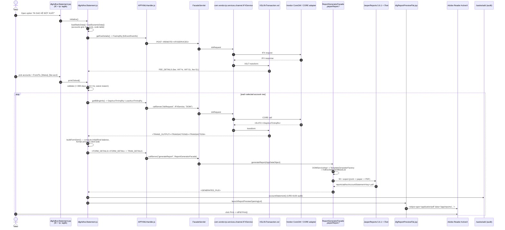
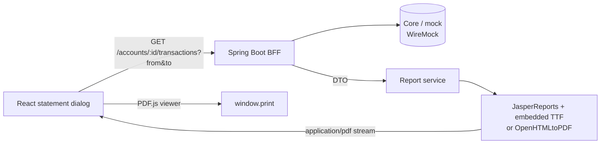

# APP — Account Statement Printing Flow ("IN SAO KÊ ĐỘT XUẤT")

> Scope: the **Ad-hoc Account Statement** print feature of Hệ thống quầy APP (Ngân hàng X build),
> i.e. the flow a teller runs to print a bank-account statement (`sao kê`) for a date range.
> Every claim below is backed by a file/line reference in this workspace.

---

## 1. Feature at a glance

| Attribute | Value |
|---|---|
| Menu label (vi) | `IN SAO KÊ ĐỘT XUẤT` — `websource/js/Lookup_vi.js:2533` (`Adhoc_Statement`) |
| Entry function | `launchAdhocStatement(objParam)` — `websource/js/optionActions.js:6086` |
| Screen | `websource/printing/dlgAdhocStatement.jsp` + `dlgAdhocStatement.js` (53 KB) |
| Data source | Vendor core via **IFX 1.5** service `DepAcctTrnInqRq` (deposits) / `LoanAcctTrnInqRq` (loans) |
| Layout engine | **JasperReports 5.6.1** template `websource/Reporting/Template/adhocAccountStatement.jrxml` |
| Output | `reports/adhocAccountStatement<CONTEXT_KEY>.pdf` served by the web app |
| Preview / physical print | `<object type="application/pdf">` (Adobe Reader ActiveX) + `idPdf.Print()` in `dlgReportPreviewFile.js` |
| Side effects | Fee/VAT charge (`XferAddRq`), VAT receipt voucher PDF, audit POST `/saoke/add` |

---

## 2. Sequence diagram



---

## 3. Step-by-step walkthrough

### 3.1 Launch

`websource/js/optionActions.js:6086`

```js
function launchAdhocStatement(objParam)
{
    if (!isHostUp()) { AppAlert(errLookup("HostDownError")); return false; }
    var strFeatures = "dialogHeight:400px; dialogWidth:758px; help:no; resizable:yes; scrollbar:no; status:no; center:yes";
    var objReturn = appModalDialog("/app/printing/dlgAdhocStatement.jsp", objParam, strFeatures);
}
```

Technology involved:
- **`isHostUp()`** — a heartbeat against the core; the whole app refuses to work if the host is down.
- **`appModalDialog`** — a wrapper over IE's `window.showModalDialog`, passing a JS object as `dialogArguments`. The child dialog reads it as `var objParam = window.dialogArguments.objModule;` (`dlgReportPreviewFile.js:1`). This API is **removed from every modern browser** — it is the single biggest blocker to porting.
- Fixed **pixel-sized dialog** (758×400) — layout is absolute, not responsive.

### 3.2 The screen

`websource/printing/dlgAdhocStatement.jsp` (100 lines) is not HTML — it is a **taglib-driven DHTML page**:

```jsp
<%@ taglib uri="/WEB-INF/app-desktop.tld" prefix="tp" %>
<tp:panel ...>
  <tp:groupbox ...>
    <tp:datepickerhtml id="dtFrom" .../>
    <tp:listview id="tblAvailabeAccts" ...>
      <tp:listviewcolumn dataField="ACCT_NBR" .../>
    </tp:listview>
    <tp:checkbox id="chkWaive" .../>
    <tp:entryfield id="txtFeeAmt" .../>
    <tp:dropdownbox id="cboFeeAssessmentAcct" .../>
    <tp:button id="btnPrint" .../>
```

The tag library is declared in `conf/META-INF/app-desktop.tld` (182 KB) and each tag emits a hand-rolled **IE DHTML widget** (attached behaviours, `ctrlAttachEvent`, `txtSetValue/txtGetValue`, `cboSetValue`, `dtDisable`, `setAllEnableDisable`, `tableView.*`). The page pulls in ~25 `<script>` files (`Forms/pdfPrinting.js`, `printing/billingstmtadvises.js`, `Workflow/workflow.js`, `tableview.js`, `dateSupport.js`, `currencySupport.js`, `localizationSupport.js`, …).

Controls on the screen:

| Control | Purpose |
|---|---|
| `dtFrom` / `dtTo` | statement period (validated ≤ 365 days) |
| `tblAvailabeAccts` | multi-select grid of the customer's deposit + loan accounts |
| `chkWaive` + `cboReason` | waive the statement fee; reason from code table `APP.CHECK_COPY_WAIVE_REASON` |
| `txtFeeAmt`, `txtVatRate`, `txtVatAmt`, `txtTotalFeeAmt` | fee + VAT, auto-filled from the fee engine |
| `cboFeeAssessmentAcct` | account to debit the fee from |
| `btnPrint` | print statement(s) |
| `btnVATReceiptVoucher` | charge the fee and print the VAT receipt voucher |

### 3.3 Fee pre-fill

`dlgAdhocStatement.js:722 getFeeDetails()` → `buildAdhocFeeInqRequest()` at `:774`

```js
service.setAttribute("name","FeeInqRq");
service.setAttribute("transformation","ifxEventFeeInfo");
// PARAMs: TRANS_AMT=20000, BRANCH_ID, FEE_TYPE=ADHOC, CUR_CODE=USD, TRN_CODE=ADHOC, REF_ID=111, REF_TYPE=A112_APP
```

Response `FEE_DETAILS` supplies `FEE_AMT`, `VAT_AMT`, `VAT_PERCENTAGE`, `FEE_GLACCOUNTID`, `VAT_GLACCOUNTID`, `FEE_TRNNAME`, `VAT_TRNNAME`, `FEE_CONFIGURED`. If `FEE_CONFIGURED != 'Y'` the fee fields are disabled and `validateFeeMsg` is raised.

### 3.4 Print click → transaction inquiry

`dlgAdhocStatement.js:180 printClicked()`

```js
var daysDiff = getDateDiff(dtF, dtT, "Days");
if (daysDiff > 365) { AppAlert(errLookup("adhocValidDateRangeMsg")); dtFrom.focus(); return; }
if (dtEndT != "" && dtBegT > dtEndT) { AppAlert(errLookup("DateSearchCriteria")); return; }
if (chkWaive.checked && cboGetValue(cboReason) == "") { AppAlert(errLookup("waiveReasonRequired")); return; }
for (var i=1; i<=tableView.count(tblAvailabeAccts); i++) {
    if (tableView.isRowSelected(tblAvailabeAccts, i)) {
        var RowObj = tableView.getNodeForRow(tblAvailabeAccts, i);
        getBillingInfo(xmlGetItemTxtByTag(RowObj,"ACCT_NBR"), xmlGetItemTxtByTag(RowObj,"HOST_APPL_ID"), dtBegT, dtEndT, RowObj);
    }
}
```

`dlgAdhocStatement.js:372 getBillingInfo()` builds the IFX envelope and calls the server **synchronously**:

```js
var xmlDom = getXMLParser("Microsoft.XMLDOM");          // IE-only ActiveX DOM
var services = xmlDom.createElement("IFXSERVICES");
var service = isLoanProduct(acctType) ? buildLoanAcctTrnInqRq(xmlDom) : buildDepAcctTranInqRq(xmlDom, RowObj);
services.appendChild(service);
appXMLHandler.addNode(services);
var objTransation = appXMLHandler.callServer("doRequest", "com.vendor.tp.services.channel.IFXService", "DOM", true, null);
var statusCode = xmlGetItemTxtByTag(objTransation, "StatusCode");
if (statusCode == status1110) { ... buildFormDom(...) } else if (ifxCheckErrors(objTransation)) { ... }
```

Request shape (`buildDepAcctTranInqRq`, `:292`):

```xml
<IFXSERVICES>
  <SERVICE name="DepAcctTrnInqRq" transformation="ifxTransaction">
    <PARAM name="ACCT_NBR">...</PARAM>
    <PARAM name="ACCT_TYPE">...</PARAM>
    <PARAM name="SEARCH_KEY">Monetary</PARAM>
    <PARAM name="BANK_ID">...</PARAM>
    <PARAM name="MAX_REC_COUNT">1000</PARAM>
    <PARAM name="START_DATE">...</PARAM>
    <PARAM name="END_DATE">...</PARAM>
    <PARAM name="SKIP_PRINT_IND">0</PARAM>
  </SERVICE>
</IFXSERVICES>
```

Loans use `LoanAcctTrnInqRq` with `transformation="ifxacctTranHistLoanAdhoc"` (`:231`).

### 3.5 Transport — `APPXMLHandler.callServer`

`websource/js/APPXMLHandler.js` wraps the payload in a `<REMOTE>` document and POSTs it to the **FacadeServlet** (`websource/WEB-INF/web.xml`), which is POST-only and returns `text/xml;charset=utf-8` (`source/com/vendor/tp/desktop/servlet/FacadeServlet.java:129-160`).

`FacadeServlet.performTask` reads a `transactions` list plus per-transaction `<id>_TARGET` / `<id>_DEPENDENCY` parameters, groups them into **independent** and **dependent** calls, optionally runs them on a thread pool (`ThreadPoolExecutor`, toggled per use-case), and concatenates the responses with a delimiter (or wraps them in `<SERVICE ID=...>` when the `Message-Type: fastinfoset` header is set). Session token is validated against `/logon/appLogon.jsp` (`:185-201`).

`_TARGET` selects the dispatcher:

| Target | Handler | Used here |
|---|---|---|
| `APPIFXSERVICE` | `com.vendor.tp.services.channel.IFXService` | ✅ transaction + fee inquiry |
| `APPCLASSLOADER` | reflective "scripts" class, e.g. `AccountStatementInqScripts` | ✅ audit call |
| `APPTRANSSERVER` | ESL action RPC to the core | (other flows) |

### 3.6 Server: IFX → core → XSLT

`source/com/vendor/tp/services/channel/IFXService.java` (`doRequest`) walks `<SERVICE name= transformation= server=>`, builds an **IFX 1.5/2.0** XML request, sends it through the **CORE** adapter (`com.vendor.core.*`, `ExportType`) to Vendor Profile/Premier, then applies the named stylesheet from `websource/XSL/`.

`websource/XSL/ifxTransaction.xsl` (8 KB) flattens the vendor response into the shape the client expects:

```xml
<xsl:template match="ns1:DepAcctTrnInqRs">
  <TRANS_OUTPUT> ... <TRANSACTIONS>
    <TRANSACTION>
      <TRANS_DATE/><TRANS_POSTING_DATE/><TRANS_DATE_TIME/><TRANS_TYPE/>
      <TRANS_AMT/><TRANS_AMT_CURCODE/><TRANS_TOT_BAL/><TRANS_TOT_BAL_CURCODE/>
      <TRANS_DESCRIPTION/><TRANS_DESC/><HIST_TRANS_DESC/><TRANS_NUMBER/><TRANS_CODE_DESC/>
```

> **Architecture note:** the XSLT is the anti-corruption layer. Business data contracts are defined by `.xsl` files, not by Java DTOs. Adding a column to a statement = editing an XSL file.

### 3.7 Client assembles the report payload

`dlgAdhocStatement.js:450 buildFormDom()` — this is where a lot of *report logic* lives in the browser:

```js
xmlSetItemTxtByTag(form,"FORM_DETAIL","FORM_TEMPLATE","adhocAccountStatement");
xmlSetItemTxtByTag(form,"FORM_DETAIL","DOCUMENT_TYPE","PDF");
// BRANCH_NAME, ACCT_TITLE, ADDRESS, CURRENCY, TRN_FROM_DATE, TRN_TO_DATE, ACCT_NUM,
// MESSAGE1/MESSAGE2 (marketing text from cwGlobalDefault), NUM_OF_DECIMALS, DECIMAL_SEP,
// THOUSAND_SEP, LANGUAGE_CODE
for (var i = count-1; i >= 0; i--) {          // transactions arrive newest-first
    trnBal = func_xmlGetItemTxtByTag(objtran, "TRANS_TOT_BAL");
    ... DEBITED_FMTAMT / CREDIT_FMTAMT via currencySupport.getFormattedCurrency(...)
    if (i == isfirstTran)  initialBalance = eval(trnBal) + eval(debitAmt) - eval(creditAmt);
    if (i == 0)            FINAL_BALANCE = currencySupport.getFormattedCurrency(trnBal, currency);
}
var objTransation = appXMLHandler.callServer("generateReport",
    "com.fisglobal.tp.forms.jasperReport.service.ReportGeneratorFacade", "DOM", true, "");
var reportUrl = xmlGetItemTxtByTag(objTransation, "GENERATED_FILE");
accountStatement(RowObj, UserName, branchNameNCode, startDate, endDate);   // URD-6100 audit
launchReportPreviewOpening(reportUrl);
```

Payload shape sent to the report engine:

```xml
<FORM_DETAILS>
  <FORM_DETAIL>
    <FORM_TEMPLATE>adhocAccountStatement</FORM_TEMPLATE>
    <DOCUMENT_TYPE>PDF</DOCUMENT_TYPE>
    <BRANCH_NAME/><ACCT_TITLE/><ADDRESS/><CURRENCY/>
    <TRN_FROM_DATE/><TRN_TO_DATE/><ACCT_NUM/>
    <MESSAGE1/><MESSAGE2/>
    <NUM_OF_DECIMALS/><DECIMAL_SEP/><THOUSAND_SEP/><LANGUAGE_CODE/>
    <ACCT_INITIAL_BALANCE/><FINAL_BALANCE/>
    <TRAN_DETAILS>
      <TRAN_DETAIL>
        <TRN_DATE/><TRN_TIME/><TRN_DESCRIPTION/>
        <DEBITED_FMTAMT/><DEBITED_AMT/><CREDIT_FMTAMT/><CREDIT_AMT/><BALANCE/>
      </TRAN_DETAIL>
      ...
    </TRAN_DETAILS>
  </FORM_DETAIL>
</FORM_DETAILS>
```

### 3.8 Audit trail (URD-6100)

`dlgAdhocStatement.js:590 accountStatement()` posts who/what/when to a **separate REST satellite**:

```js
appXMLHandler.addItem("CUST_CIF", ...); // CUST_NAME, CUST_TYPE, CUST_BRANCH
appXMLHandler.addItem("ACCT_CIF", ...); // ACCT_NO, ACCT_TYPE, ACCT_TITLE, ACCT_BRANCH
appXMLHandler.addItem("HIST_CIF_NO", ...); // HIST_ACCT_NO, HIST_BRANCH, HIST_USER_REQ,
                                          // HIST_DATE_REQ, HIST_FROM_DATE, HIST_TO_DATE
var objTickets = appXMLHandler.callServer("accountStatementInq", "AccountStatementInqScripts", "DOM");
```

`source/com/vendor/tp/desktop/servlet/AccountStatementInqScripts.java` maps these into `StamentHistoryTransactionRq` (note the typo in the class name — it is real) from `source/com/bank/model/accountstatement/`, then calls `RestService.postNEW("/saoke/add", ...)`. DTOs: `AccountStatementCustInfo`, `AccountStatementAcctInfo`, `AccountStatementHistInfo`.

> Quirk: this class obtains the Spring bean named `"<bean khác>"` where the rest of the codebase uses `restService`. Worth checking before copying.

### 3.9 Server: JasperReports pipeline

```
ReportGeneratorFacade.generateReport(AppDataObject)          source/com/fisglobal/tp/forms/jasperReport/service/
  └─ getServiceClass(objRequest)   -> DOMServiceImpl | EslServiceImpl | DatabaseServiceImpl | IFXServiceImpl
  └─ service.performActions(...)   -> List<Object> of result XML
  └─ ReportUIBuilder.generateReport(FormType, results, req, EXPORT_TYPE, isFromDB)
       ├─ TemplateGenaratorFactory.createDataForReport(...)
       │     switch(formType) case ADHOC_STATEMENT:
       │        new AdhocStatementBeanList().getDataBeanList(req, result)   // DOM -> List<AdhocStatementBean>
       │        .setTemplateParameters(...)                                  // Map<String,Object> for Jasper
       ├─ JRBeanCollectionDataSource(beanList)
       └─ ReportFactory(exportType).generateReport(beanList, ...)
            ├─ getFilePath(template, "/Reporting/Template/", "jasper")
            ├─ if (!jasper.exists() && jrxml.exists()) ReportUtil.compileReport(...)   // lazy .jrxml -> .jasper
            ├─ JasperFillManager.fillReportToFile(jasper, parameters, dataSource)
            └─ switch(exportOption)
                 case PDF:   ReportUtil.generatePDFFile(...)   // JasperExportManager / iText
                 case EXCEL: generateXlsFile(...)              // JRXlsExporter
                 case CSV:   generateCSVFile(...)              // JRCsvExporter
  └─ return "<GENERATED_FILE>adhocAccountStatement<CONTEXT_KEY>.pdf</GENERATED_FILE>"
```

Constants (`source/com/vendor/appgt/AppConstants.java:72-78`):

| Constant | Value |
|---|---|
| `JASPER_TEMPLATE_PATH` | `Reporting/Template/` |
| `JASPER_REPORT_PATH` | `reports/` |
| `FILE_TEMP_EXT` / `FILE_JR_EXT` | `jrxml` / `jasper` |
| `GENERATE_PDF` / `GENERATE_EXCEL` / `GENERATE_CSV` | `PDF` / `XLS` / `CSV` |

`FormType.ADHOC_STATEMENT("adhocAccountStatement")` — `service/FormType.java:12`.

### 3.10 The template

`websource/Reporting/Template/adhocAccountStatement.jrxml` (26 KB, compiled sibling `.jasper` 65 KB):

- `pageWidth="595" pageHeight="842"` → **A4 portrait**
- `language="groovy"` → Jasper expression language is Groovy (`groovy-all-2.0.1`)
- **15 `<parameter>`s** matching the `FORM_DETAIL` header, **6 `<field>`s** matching `TRAN_DETAIL`
- Vietnamese static labels (`SAO KÊ TÀI KHOẢN`, `Số dư đầu kỳ`, `Ngày giao dịch`, …)
- Every text element: `fontName="OptimaVU" pdfEncoding="Identity-H" isPdfEmbedded="true"`

Vietnamese diacritics in PDF require all three of those attributes plus a registered font family:

```
source/jasperreports_extension.properties
  net.sf.jasperreports.extension.registry.factory.fonts=...SimpleFontExtensionsRegistryFactory
  net.sf.jasperreports.extension.simple.font.families.for.export.PDF=isofonts
websource/Fonts/isofonts.xml   -> OptimaVU.ttf, OptimaVUBold.ttf, OptimaVUItalic.ttf, OptimaVUBoldItalic.ttf,
                                  tahoma.ttf, tahomabd.ttf, vuArial*.ttf, vuTimes*.ttf
```

### 3.11 Preview and physical print

`websource/js/MiscScript.js:934 launchReportPreviewOpening(reportUrl)` opens the modal `websource/BPModules/dlgReportPreviewFile.jsp`.

`dlgReportPreviewFile.js`:

```js
function LoadAndPrint(url) {
  footer.innerHTML = '<object id="idPdf" width="925" height="655" type="application/pdf"'
    + 'data="' + url + '?#view=Fit&scrollbar=0&toolbar=0&navpanes=0">'
    + '<span>PDF plugin is not available.</span></object>';
}
function loadPDF() { ... LoadAndPrint("/app/reports/" + strLocation); }

function PrintPdf() {
  if (... objParam.formName == "Receipt Voucher") { updateRepId(objFormData); }
  idPdf.Print();                       // Adobe Reader ActiveX method
}
```

So the **physical printer is never addressed by the server** in this flow. The PDF is written to disk under the web root, streamed back over HTTP, rendered by the **Adobe Reader browser plugin**, and printed by that plugin's `Print()` API. A batch variant uses a hidden `IFRAME` instead of `<object>`, and `hideLoading()` auto-closes the dialog for `rtf|xls|doc` (i.e. those formats just download).

There *is* a server-side direct-print path — `ReportFactory.printReport(...)` (`:281`) using `javax.print.PrintServiceLookup` + `JRPrintServiceExporter` — but `ReportUIBuilder` comments it out in favour of `groupReport` and the code is annotated `/** Direct print is not in use **/`.

### 3.12 Fee charge + VAT receipt voucher (same screen, second button)

`dlgAdhocStatement.js:1105 btnReceiptVoucherClick()`

```
btnReceiptVoucherClick
 ├─ if (isFeeAmtChanged || strWaiveFlag) processAPPOverrideDialog(...)   // supervisor override, :1072
 ├─ else addFundsTransfer()                                               // :827
 ├─ if (blnFundTrnStatus_g) generateAdhocDialogBoxReportData()            // :1123
 └─ disable fee/date/account controls
```

`addFundsTransfer()` builds an **IFX `XferAddRq`** through the `IFXTransaction` client helper (`new IFXTransaction("XferAddRq","DDA",true,true,false,"Bank")`):

- `DepAcctIdFrom` = fee-assessment account, `DepAcctIdTo` = same account with `AcctType="Adhoc"`
- `CurAmt {Amt, CurCode, CurRate, CurConvertRule="DIRECT"}`
- Non-VND accounts trigger **FX conversion** via `processConvertedAmount(...)` (returns `BUY_RATE`) and an extra `ForExRateInfo` section
- `com.ctg:FeeInfo` with two `com.vendor:FeeVatInfo` legs — `Type=FEE` → `feeGLAccountId`, `Type=VAT` → `vatGLAccountId` — both `AcctType="GL"`
- `XferAdditionalInfo.TrnType = "Adhoc Transfer"`, `TransDescType = "Debit"`

`generateAdhocDialogBoxReportData()` then emits **two** `FORM_DETAIL`s in one request — `adhocDialogBoxReport` (bank copy) and `adhocDialogBoxReportCustcopy` (customer copy) — with ~40 `ADHOC_INFO` fields (branch tax code, invoice number/serial/sign, `AMOUNT_WORDS` from `toWords(...)`, cash-drawer fields, `SOFTWARE_PROVIDER`, marketing messages, `SUPERVISOR_ID`), and calls:

```js
appXMLHandler.callServer("PrintgeneratedReport",
    "com.fisglobal.tp.forms.jasperReport.service.PrintReportGeneratorFacade", "DOM", true, "");
```

`PrintReportGeneratorFacade.PrintgeneratedReport` → `ReportUIBuilder.groupReport` → `ReportFactory.groupPDFReport(ArrayList<FormDetails>, ServletContext)` (`:341`), which fills each template into a `List<JasperPrint>` and merges them into **one** PDF (`ReportUtil.pdfExportService`). This is how a single print job produces a 2-page bank+customer voucher.

---

## 4. Related "statement" flows (do not confuse them)

| Flow | Files | What it does |
|---|---|---|
| **Ad-hoc statement print** (this doc) | `printing/dlgAdhocStatement.*` | on-demand PDF for an arbitrary date range |
| On-screen transaction history | `account/tabTransactions.js`, `account/DepositAccount/tabTransactions_DDA.js`, `tabTransactionsCD.js` | same `DepAcctTrnInqRq` + `ifxTransaction`, rendered in a grid, **no PDF** |
| Statement **copy** research (maker–checker case) | `WorkflowSI/ResearchStatementCopy.js`, `BPModules/tabResearchRequestStatement.js`, `doc/DataBlob Documentation/statementCopy/statementCopy.xml` | retrieves an *archived* statement via `WFGetItem` / `RAW_DATA_BINARY` / `WF_ITEM_FORMAT=FML` |
| Periodic statement advise | `printing/billingstmtadvises.js` | `BillingStmtAdviseRq` via `AppClassLoader` → `APPIFXService` |
| Account-statement info query | `desktop/servlet/AppAccountDetailScripts.java:406 getAcctStatementsInfo()` | `DepAcctStmtInqRq` (list of generated statements, not the content) |
| SoftPro form printing | `Workflow/printForms.js` (`/app/APPPDFPrintForms`), `Forms/pdfPrinting.js` | `FormPrintInqRq` + `fnis.temp:MergeIndicator/SilentPrintIndicator/Simplex`, global `IS_PRINTER_SIMPLEX` — the *other* PDF stack, used for pre-printed forms |

---

## 5. Technology inventory for this flow

| Layer | Technology | Evidence |
|---|---|---|
| Browser | **Internet Explorer** only | `getXMLParser("Microsoft.XMLDOM")`, `window.showModalDialog`, `document.frames`, `navigator.userAgent.indexOf("MSIE")` |
| UI widgets | Custom JSP taglib → DHTML | `conf/META-INF/app-desktop.tld` (182 KB), `tp:listview`, `tp:datepickerhtml` |
| Client language | **ECMAScript 3**, global functions, `with(objTrans){...}` | `dlgAdhocStatement.js` |
| App state | `top.miscData` global XML document (session cache) | `xmlGetItemTxtByTag(top.miscData,"ACTIVE_BANK")` |
| Transport | Single POST endpoint, XML body, synchronous XHR | `FacadeServlet.java:129` |
| Core protocol | **IFX 1.5/2.0** XML over **CORE** adapter to Vendor Profile/Premier | `IFXService.java`, `com.vendor.core.ctg.ExportType` |
| Contract mapping | **XSLT 1.0** stylesheets | `websource/XSL/ifxTransaction.xsl` |
| Report engine | **JasperReports 5.6.1**, expressions in **Groovy 2.0.1** | `build.jenkins/build.properties`, `adhocAccountStatement.jrxml` |
| PDF writer | **iText** (bundled with JasperReports) | `JasperExportManager.exportReportToPdfFile` |
| Excel/CSV export | `JRXlsExporter`, `JRCsvExporter` | `ReportUtil.java` |
| Font embedding | TTF + `Identity-H` via font-extension registry | `jasperreports_extension.properties`, `websource/Fonts/isofonts.xml` |
| Server printing (unused) | `javax.print` + `JRPrintServiceExporter` | `ReportFactory.printReport:281` |
| PDF viewer/printer | **Adobe Reader ActiveX plugin** | `dlgReportPreviewFile.js:38` |
| Audit | REST + OAuth2 to a sidecar service | `AccountStatementInqScripts` → `RestService.postNEW("/saoke/add")` |
| DI / config | Spring 2.5.6 XML beans | `conf/appbeans_app.xml`, `conf/appbeans_forms.xml` |
| Logging | Log4j + `APPLogFormatter` MDC | `source/appLog4j.xml`, `FacadeServlet:159` |
| File handoff | PDF written under the web root, fetched by URL | `AppConstants.JASPER_REPORT_PATH = "reports/"` |

---

## 6. Known weaknesses to avoid in a clone

Đã lược bỏ khỏi tài liệu này (thông tin lỗi của hệ thống thật không đưa lên nơi công khai).

---

## 7. How to mock this flow today

### 7.1 Minimum viable clone (one screen, one PDF)



| Concern | Legacy APP | Use instead |
|---|---|---|
| Screen | `tp:` taglib + IE DHTML | React/Vue + a JSON-UI schema (keeps the "screen defined by metadata" idea without ActiveX) |
| Date range / multi-select grid | `tp:datepickerhtml`, `tp:listview` | `<input type=date>` + a data grid (AG Grid / TanStack Table) |
| Transport | `callServer` → XML `<REMOTE>` → `FacadeServlet` | `fetch` → REST/JSON, one endpoint per use-case |
| Core call | IFX 1.5 XML + CORE | REST/gRPC to the core; **keep an anti-corruption mapper** (MapStruct / hand-written) in place of XSLT |
| Response shaping | `ifxTransaction.xsl` | Java DTO → JSON; or XSLT only if the core really speaks IFX |
| Report layout | `adhocAccountStatement.jrxml` (Groovy) | Keep **JasperReports** if you want to reuse the `.jrxml` (it still runs on JR 6.x/7.x, Java expressions instead of Groovy); or rewrite in OpenHTMLtoPDF / Flying Saucer with Thymeleaf HTML templates |
| Vietnamese PDF | `OptimaVU` + `Identity-H` + `isPdfEmbedded` | **Same requirement** — ship a Unicode TTF subset and force embedding; this is the #1 thing people get wrong |
| Amount formatting | `currencySupport.getFormattedCurrency` in JS | Format **once on the server** with `DecimalFormat`/`NumberFormat` per locale; send both raw and formatted values |
| Balances | computed in browser | computed by the report service or read from the core |
| Preview/print | Adobe ActiveX `<object>` + `idPdf.Print()` | stream the PDF and render with **PDF.js**; print via `window.print()` on a print stylesheet, or `pdfjs-dist` → `PrintService` |
| File storage | `reports/` under web root | store in object storage / temp dir, serve via **authenticated, short-lived signed URL** (or don't store at all — stream it) |
| Fee + VAT | `XferAddRq` IFX from the browser | a `POST /statements/:id/charge` command with an idempotency key + saga |
| Supervisor override | `openSupervisorOverrideDialog` | step-up auth / second-factor approval in the BFF |
| Audit | `POST /saoke/add` | an `event_history` table write in the same DB transaction, or an outbox event |
| Multi-copy voucher | `groupPDFReport` merging `List<JasperPrint>` | JasperReports subreports, or PDFBox `PDFMergerUtility` |
| Code tables | `AppCodeTable` / `APP.CHECK_COPY_WAIVE_REASON` | a `code_table(code_set, code, description_en, description_vi)` table + lookup endpoint |
| i18n | `errLookup()`, `Lookup_vi.js`, `LANGUAGE_CODE` param | `react-intl` + a `language` param passed into the report |

### 7.2 Suggested endpoints for the mock

```
GET  /api/customers/{cif}/accounts                      -> list for the grid
GET  /api/accounts/{id}/transactions?from&to&page&size  -> rows + openingBalance + closingBalance
GET  /api/accounts/{id}/statement-fee                   -> { feeAmount, vatRate, vatAmount, configured }
POST /api/accounts/{id}/statement                       -> { from, to, language, waive, feeAccountId }
     -> 200 application/pdf   (streamed)
     -> or 202 { reportId } + GET /api/reports/{reportId}  (async, better for >1000 rows)
POST /api/accounts/{id}/statement/charge                -> fee + VAT posting, returns voucher pdf
```

Server-side report contract (JSON, mirroring the old `FORM_DETAIL`):

```json
{
  "template": "adhocAccountStatement",
  "output": "PDF",
  "header": {
    "branchName": "...", "accountTitle": "...", "address": "...", "currency": "VND",
    "fromDate": "2026-01-01", "toDate": "2026-11-20", "accountNumber": "...",
    "openingBalance": 1500000, "closingBalance": 2750000,
    "locale": "vi", "marketingLine1": "...", "marketingLine2": "..."
  },
  "transactions": [
    { "date": "2026-01-05", "time": "09:12:33", "description": "...",
      "debit": 200000, "credit": null, "balance": 1300000 }
  ]
}
```

Send **numbers as numbers** and let the report layer format them — the opposite of APP, which formats in JS and sends both `DEBITED_AMT` and `DEBITED_FMTAMT`.

### 7.3 Reusing the existing layout

`websource/Reporting/Template/adhocAccountStatement.jrxml` is directly portable:

1. Drop it into a Spring Boot project's `src/main/resources/reports/`.
2. Add `net.sf.jasperreports:jasperreports:6.21.x` (or 7.x) + a Groovy or Java expression compiler.
3. Register the fonts: copy `websource/Fonts/*` and `jasperreports_extension.properties` — this is what makes `ị ẹ ả ã ơ ư` render.
4. Replace `AdhocStatementBeanList`'s DOM parsing with Jackson JSON binding; keep the `Map<String,Object> parameters` + `JRBeanCollectionDataSource` contract unchanged.
5. `JasperExportManager.exportReportToPdfStream(jasperPrint, response.getOutputStream())` — no temp file, no `reports/`.

That single change (Jasper + embedded TTF + streamed PDF) reproduces ~90 % of the visual output of APP statement printing with a fraction of the machinery.

---

## 8. One-line summary

APP statement printing is **IE DHTML screen → synchronous XML POST to one facade servlet → IFX request to the Vendor core → XSLT flattening → the browser re-assembles a `FORM_DETAIL` payload (including balance math) → JasperReports compiles/fills/exports a `.jrxml` to a PDF under the web root → the PDF is streamed back and printed by the Adobe Reader ActiveX plugin**, with a fee/VAT `XferAddRq` posting and a `/saoke/add` audit REST call bolted onto the same screen.
